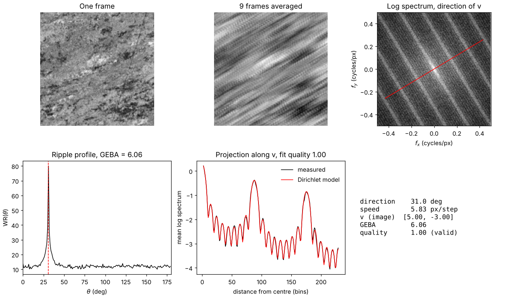

# 2D-FFT velocity estimation from a single image

[](https://github.com/onewmann/2D-FFT-Code/actions/workflows/ci.yml)

Estimates direction and speed of a moving surface from one image. The camera
integrates several short exposures (pulses) into one frame while the surface
moves. That motion leaves a pattern of straight lines in the image spectrum:
their orientation gives the direction, their spacing the speed. A Radon
transform of the log spectrum finds both.

The method is not my own. It comes from the doctoral thesis of Jan Horn at
Universität Karlsruhe (TH) ([reference](#reference)), which I implemented in
my student project. This repository is a reworked version of that
implementation, done with the assistance of AI;
[How this was built](#how-this-was-built) says from which point on. What it changes compared with the thesis is listed under
[Background](#background).

The same algorithm runs in MATLAB, GNU Octave and Python and gives identical
results (differences below 1e-9). The MATLAB/Octave code needs no toolbox.



*Simulated pulsed image of a real surface (recorded with a Basler camera), moving
by (5, -3) px per exposure. Estimate: 30.98 deg and 5.83 px per step, true
values 30.96 deg and 5.83 px.*

## How it works

The pulsed-exposure model, steps 1 and 2 and the quality measure GEBA follow
Chapter 3 of the thesis. The thesis takes the speed from the spacing of the
peaks in the projection; steps 3 and 4 replace that with a model fit and a
validity check added in this implementation.

A pulsed-exposure image is the mean of $2L+1$ exposures of a texture $b$ that
moves by $\mathbf v$ between two exposures:

$$b_p(\mathbf x) = \frac{1}{2L+1}\sum_{k=-L}^{L} b(\mathbf x - k\mathbf v)
\quad\Longrightarrow\quad
B_p(\mathbf f) = B(\mathbf f)\,D(\mathbf f\cdot\mathbf v),\qquad
D(u) = \frac{\sin\big((2L+1)\pi u\big)}{(2L+1)\sin(\pi u)}$$

The Dirichlet kernel $D$ is 1 wherever $\mathbf f\cdot\mathbf v$ is an integer,
so the spectrum carries lines perpendicular to $\mathbf v$, spaced $1/|\mathbf v|$
cycles per pixel apart, with $2L-1$ weaker side lobes in between.

1. **Spectrum.** Remove the mean, apply a 2-D Hann window, zero-pad the FFT to
   twice the image size and take $\log(|B_p| + 0.05\,\mathrm{median}|B_p|)$.
   A non-square image is cropped to its central square (or a smaller central
   square, option `roi`), never resized. With the option `clip_outliers`,
   pixels more than 6 robust standard deviations from the median are first set
   to the median.
2. **Direction.** Average the log spectrum along parallel lines for every angle
   $\theta$ (a Radon transform that uses the mean instead of the sum, so the
   square support does not favour the diagonals). Only the projection along
   $\mathbf v$ turns the lines into a sharp comb, so the ripple profile
   $WR(\theta) = \sum_r |\partial_r R(r,\theta)|$ peaks at the direction of
   motion. GEBA $= \max WR / \mathrm{mean}\, WR$ measures how clearly it does.
3. **Speed.** Compare the projection along that direction with the expected
   profile for $2L+1$ exposures on a grid of speeds. For a random texture the
   expected power at bin $j$ is

   $$P(j) = \frac{1}{(2L+1)^2}\Big[(2L+1) + 2\sum_{m=1}^{2L}(2L+1-m)\,
   \rho(m\mathbf v)\cos\Big(\frac{2\pi j m |\mathbf v|}{N_\mathrm{pad}}\Big)\Big]$$

   where $\rho(m\mathbf v)$ is the autocorrelation of the window at the offset
   between two exposures $m$ steps apart. This closed form includes the blur
   caused by the window and cannot alias. For another number of exposures $K$
   (option `exposures`, also even) $2L+1$ is replaced by $K$. If each exposure
   lasts the fraction $d$ of a step (option `duty`), the texture moves by
   $d\,|\mathbf v|$ during it, and $P(j)$ is multiplied by
   $\mathrm{sinc}^2(j\,d\,|\mathbf v|/N_\mathrm{pad})$. A cubic polynomial
   absorbs the smooth spectrum of the texture; the speed with the highest
   correlation wins, and that correlation is the fit quality.
4. **Validity.** An estimate counts as valid if the fit quality reaches a
   threshold, the speed lies inside the measurable range and the spectrum is
   not isotropic. The threshold is 0.6 for images from about 200 px upwards.
   Smaller images need more, $\tanh(9/\sqrt{m-5})$ for a profile of $m$
   independent points (0.70 at 128 px, 0.85 at 64 px), because a short profile
   matches some model speed by chance. Zero padding beyond the default factor 2
   adds no independent points and does not lower the threshold. The constant
   comes from 1008 images without motion (32 to 256 px), none of which passes;
   at 32 px about 1 in 1000 such images still passes. For the isotropy check
   the profile perpendicular to the found direction is fitted as well. Motion
   makes the spectrum anisotropic, so that fit is clearly worse or gives
   another speed. If its quality is less than 0.15 lower and its speed within a
   factor $e^{0.12} \approx 1.13$, the structure is isotropic (for example
   defocus blur or a square repeating texture) and the estimate is not valid.
   Images of a static, non-repeating texture in focus, images with strong noise
   and images with erratic steps are rejected. A regular pattern of uneven
   steps (one dropped exposure, alternating intervals) or a speed that changes
   during the exposures can still pass with a wrong speed, often twice the
   true one, so the acquisition has to guarantee equal steps. The
   [Limitations](#limitations) list further cases that can pass with a wrong
   speed.

Directions are given in degrees, counter-clockwise from the x axis as seen on
screen, in [0, 180). One image cannot tell $\mathbf v$ from $-\mathbf v$.

## Results

All numbers come from `experiments/run.py` with default options; the CSV
files are in `experiments/results/`. `--quick` runs smaller grids and writes
to `experiments/results_quick/` instead, which git ignores. Each study can also
run on its own, for example `python experiments/noise.py --quick`.

**Accuracy.** For 256 x 256 px and 9 exposures the direction is within
0.71 deg and the speed within 0.5 % from 0.4 to 64 px per step (within 0.09 deg
from 1 px per step up). With 41 exposures the range starts at 0.1 px per step.
A real surface texture gives the same accuracy as a random one. Slower motion
is reported as out of range, not as a wrong speed.


**Ground truth.** On the test sequences of the original project, which move by
exactly (5, 5) and (4, 4) px per frame, every 9-frame window gives
135.0 &plusmn; 0.07 deg and a speed within 0.005 px per frame. The other two
sequences break the model on purpose. Where the speed changes inside the window
(third panel), 17 of 22 windows are valid and within 11.1 % of the mean motion.
With irregular steps of 3.5 to 9.9 px (fourth panel), only 4 of 22 windows
pass, within 14.4 %; the rest, including estimates of almost twice the speed,
are rejected.


**Noise.** With random velocities between 1 and 32 px per step and white noise
of half the signal's standard deviation, 81 % of the estimates are correct
(direction within 2 deg, speed within 5 %); with noise as strong as the signal,
61 %. The validity check keeps most failures out: 11 of 592 valid estimates
missed the criterion, six by a direction error of 2.0 to 3.7 deg and five
with twice the true speed (these five at noise of half the signal or more).
None of 120 images without motion was marked valid. The isotropy check
changes none of these numbers: the 16 images it flags also fail the quality
threshold.


**Before and after.** On the same 36 simulated images the speed estimate of
the original code is off by 733 % (median), the rewrite by 0.018 %. The
original code found the direction in 31 of 36 cases but took its speed from
noise peaks, so it reported 32 to 78 px per step whatever the true speed.


## Quick start

### Python

Python 3.10 or newer. Upgrade pip first: editable installs without `setup.py`
need pip 21.3 or newer, and older Python versions bring an older one.

```bash
python -m pip install --upgrade pip
python -m pip install -e "./python[examples]"
python -m fftvel simulate --vx 5 --vy -3 --plot estimate.png
python -m fftvel estimate my_pulsed_image.png --L 4          # 2L+1 = 9 exposures
python -m fftvel estimate frames.mat --stack --L 4           # mean of the first 9 frames of a stack
```

The core (`python -m pip install -e ./python`) needs only numpy and reads
`.npy` files. The extras add: `data` scipy, h5py and Pillow for `.mat` and
image files, `plot` matplotlib for `--plot` and the figures, `video` OpenCV
for webcams and video files in the live script, `test` pytest and the test
dependencies; `examples` holds `plot`, `data` and `video`. `examples` and
`video` install `opencv-python-headless`. If `opencv-python` is already
installed (for example for other scripts that open windows), install
`"./python[plot,data]"` instead and keep your OpenCV: both packages provide the
same `cv2` module and overwrite each other's files. The live script works with
either.

`python -m fftvel estimate FILE` writes the result as JSON to stdout and notes
on what was read and used (variable, frames, analysed square, model) to
stderr. Its options:

* `--L L` or `--exposures K`: the number of exposures, 2L+1 or any K >= 2
  (also even). A single image needs one of them; a wrong count scales the
  speed by K_true/K, and the result can still be marked valid. In the JSON, `L`
  is null for an even K.
* `--stack`: the file holds frames, and their mean is the pulsed image:
  all frames (an odd number is required) or the first 2L+1 or K. MATLAB
  `getdata` stacks (H x W x 1 x F) and frames-first arrays (F x H x W, for
  example `np.stack` of a list of frames) work as they are;
  `--frames-axis first|last` decides when the shape does not tell.
* `--duty D`: duration of one exposure (camera exposure time or flash pulse)
  divided by the time step, see [Limitations](#limitations).
* `--roi N`: side of the analysed central square, default 512 px, 0 for the
  largest square (the default of the functions). The run time grows with N^2.
* `--clip-outliers`: set static bright spots and hot pixels to the median
  before the FFT.
* `--var NAME`: the variable in a `.mat` file. Needed if the file holds
  several arrays and none is the only image (with `--stack`: the only stack).
* `--plot PNG`: save the diagnostic figure; works without a display.

Files: PNG, TIFF, BMP and JPEG are read with Pillow and keep 16-bit, 32-bit
integer and float32 data; colour becomes grey, a multi-page TIFF a stack, and
float64 TIFF needs tifffile. `.npy` files are memory-mapped, so only the frames
used are read. `.mat` files need scipy, MATLAB v7.3 files also h5py. Octave's
default `save` writes text, which is not a MAT-file: use
`save('-v7', file, 'frames')`. Struct and cell variables must be saved as plain
arrays. Use lossless formats for measurements: JPEG adds an 8 x 8 px block
grid, and the command line warns for JPEG input.

```python
from fftvel import estimate_velocity, pulsed_from_stack, simulate_pulsed_image

bp = simulate_pulsed_image(256, v=(5, -3), L=4)    # or: bp, K = pulsed_from_stack(frames, L=4)
est = estimate_velocity(bp, L=4)                   # or: estimate_velocity(bp, exposures=K)
print(est.angle_deg, est.speed, est.quality, est.valid)
```

### MATLAB or GNU Octave

```matlab
addpath('matlab')                       % the folder that holds +fftvel
bp  = fftvel.simulate_pulsed_image(256, [5 -3], 4);
est = fftvel.estimate_velocity(bp, 'L', 4, 'Diagnostics', true);
fftvel.plot_estimate(bp, est);

frames  = getdata(vid, 9);                     % camera frames, H x W x 1 x 9
[bp, K] = fftvel.pulsed_from_stack(frames);    % mean of the 9 frames
est = fftvel.estimate_velocity(bp, 'Exposures', K, 'ROI', 512);
```

`fftvel.pulsed_from_stack` (same name in Python) takes the frames
along the last dimension and drops other dimensions of length 1. Without
`'L'` or `'Exposures'` it averages all frames, which must then be an odd
number; with one of them it averages the first 2L+1 or K frames. Pass K on to
`estimate_velocity`.

Options, the same in both languages (MATLAB name-value pairs, Python keyword
arguments):

| MATLAB | Python | Default | Meaning |
|---|---|---|---|
| `'L'` | `L` | 4 | half the number of exposures, 2L+1 in total |
| `'Exposures'` | `exposures` | `[]` / `None` (2L+1) | exact number of exposures K >= 2, also even; overrides L |
| `'Duty'` | `duty` | 0 | duration of one exposure (flash pulse or camera exposure time) divided by the time step, in [0, 1) |
| `'ROI'` | `roi` | `[]` / `None` (largest square) | side of the analysed central square, at least 16 px |
| `'ClipOutliers'` | `clip_outliers` | false | set pixels more than 6 robust standard deviations from the median to the median |
| `'PadFactor'` | `pad_factor` | 2 | zero padding factor of the FFT |
| `'MinQuality'` | `min_quality` | 0.6 | lowest fit quality accepted; small images need more |
| `'Diagnostics'` | `diagnostics` | false | keep intermediate results for `fftvel.plot_estimate` |

The result has the fields `angle_deg`, `speed` (px per exposure step), `vx`,
`vy`, `geba`, `quality`, `quality_perp` (the fit perpendicular to the
direction), `in_range`, `isotropic`, `threshold`, `valid` (quality >= threshold
and in range and not isotropic), `L`, `exposures` (K used in the model), `n`
(side of the analysed square) and `npad`. Option values are checked: text such
as `'4'` is an error, so MATLAB command syntax does not work for numeric
options.

`matlab/examples/demo_simulation.m` and `demo_testsequences.m` run unchanged in
both. On a 2.8 GHz Xeon a 256 x 256 image takes about 0.8 s in Python and
1.2 s in Octave (the first call in a session 1.1 s and 1.7 s), a 512 x 512
square about 5 s and 6 s. A full camera frame of 1216 x 1936 px, analysed as a
1216 px square, takes about 50 s and 85 s, so analyse a central square of 256
to 512 px (`roi`, `--roi`, or a camera ROI).

### Live camera

* MATLAB: `matlab/examples/live_basler.m` streams from a Basler camera through
  the Image Acquisition Toolbox (GenTL).
* Python: `python/examples/live_camera.py --source pylon` does the same with
  [pypylon](https://github.com/basler/pypylon); `--source 0` uses any webcam
  and `--source video.avi` a recording (both through OpenCV).

Both need an explicit mode:

* `flash`: every camera frame holds K = 2L+1 strobe flashes (or
  `--exposures K` / `'Exposures', K`) and is estimated on its own. The speed is
  in px per flash step, and in px/s only with the time between flashes
  (`--flash-period` / `'FlashPeriod'`, in s). `--duty` / `'Duty'` is the flash
  pulse length divided by the flash period. The exposure must cover all K
  flashes; with the flash period given, both scripts read the exposure time
  of a Basler camera and warn when it is shorter than (K - 1 + duty) flash
  periods. With a strobe that is not synchronised with the exposure, the
  number of flashes per frame can change from frame to frame.
* `average`: continuous light, K consecutive frames are averaged into a pulsed
  image. The speed is in px per frame and px/s. Never use this mode for
  multi-flash frames.

```bash
python python/examples/live_camera.py --mode flash --source pylon --L 4 --flash-period 0.001
python python/examples/live_camera.py --mode average --source pylon --exposure-us 500
python python/examples/live_camera.py --mode flash --source recording.avi
```

```matlab
live_basler('Mode', 'flash', 'L', 4, 'FlashPeriod', 1e-3)
live_basler('Mode', 'average', 'Exposure', 500)
```

Frame times (average mode). The model needs equal steps, so both scripts check
the frame times. A window is accepted if the spread of its frame intervals
(max - min) is at most 0.1 times their median (`--tol` / `'Tol'`); Python
reports other windows as not valid ("uneven frame steps"), MATLAB skips them.
The Python script uses the camera clock of Basler cameras. If the camera sends
no timestamps (as the pylon emulator), it uses the host clock and checks the
window against the nominal frame period. Webcams use the driver's buffer time
or the host clock. The MATLAB script gets its times from `getdata`, which
takes them on the host when a frame arrives, not from the camera clock (that
would need GenICam chunk data, which the script does not use). It therefore
checks windows against the frame rate the camera reports: if the mean
interval agrees with it within `Tol`, the window is accepted unless an
interval is off by half a period or more (a dropped frame). This assumes a
free-running camera, not a hardware trigger. Without a reported rate, or if
the mean interval does not agree with it, MATLAB uses the spread test. The
Python host-clock fallback for Basler cameras uses the same rule. Video files
only carry nominal times (frame number divided by the frame rate stored in the
file): they cannot reveal dropped frames, and px/s is only as right as that
frame rate. Image sequences need `--fps`.

Exposure (average mode). Each frame is blurred over its exposure time.
`--exposure-us` / `'Exposure'` (in us) sets a fixed exposure and switches auto
exposure off (`ExposureTime`, or `ExposureTimeAbs` on older GigE cameras).
For Basler cameras both scripts read the exposure back and pass
duty = exposure / frame step to the estimator (webcams and video files use
duty 0 unless `--duty` is given). They warn between 0.4 and 0.6, where the
result depends strongly on the exact value, and above 0.9. Keep the exposure
below about 0.3 of the frame step.

The Python script grabs a fresh burst of K frames for every estimate in
average mode and the newest frame in flash mode, so frames buffered while it
computes never end up in a window. It reads the pixel format back: Mono8,
Mono10, Mono12 and Mono16 are used directly, packed Mono formats are converted,
Bayer and colour formats are refused with a message. Failed grabs are
printed; it stops after 20 failed grabs or incomplete bursts in a row, or
after 10 failed webcam reads. `--show` plots the speed over time and keeps the
plot open at the end. The default `--roi 512` takes several seconds per
estimate.

Neither script has been run on camera hardware for this repository. The
Python script was checked against the pylon camera emulator in both modes (in
flash mode with simulated 9-flash frames: 3.60 to 3.61 px per flash, true
3.61) and on video files and image sequences through OpenCV. `live_basler.m`
was run in GNU Octave with mock Image Acquisition Toolbox objects only, not in
MATLAB.

## Repository layout

```
matlab/+fftvel/       MATLAB/Octave package fftvel (no toolboxes); helpers in +internal/
matlab/examples/      demos and the live Basler GUI
python/               the same as the Python package fftvel, plus examples
tests/                test suites for both languages and shared parity cases
experiments/          one script per study; run.py runs them all
experiments/history/  the 2025 estimator ported to Python, before/after comparison
experiments/results/  CSV files of the full run (--quick writes to the ignored results_quick/)
data/                 test sequences, a real surface texture, the Basler recordings
docs/figures/         figures of this README
```

## Tests

```bash
python -m pip install -e "./python[test]"
python -m pytest tests/python
octave --no-gui --eval "cd tests/matlab; run_tests"     # or: matlab -batch "cd tests/matlab; run_tests"
```

The suites check the angle convention, known motion in simulations and on the
test sequences, rejection of static scenes and white noise from 32 to 256 px,
of defocused images and square repeating textures (isotropy check) and of
motion below the measurable range, the options `exposures`, `duty`, `roi` and
`clip_outliers`, the checks of all option values, `pulsed_from_stack`, and
parity: the same 15 cases (including odd sizes, a non-square image, other FFT
lengths, 8 exposures, a duty, a small ROI, clipped hot pixels, a uint8 frame
stack and a static repeating tile) must give the same result in both
languages within 1e-9. The no-motion checks at 32 px use stored images
(`tests/parity/fixed_inputs.mat`, written by `tests/parity/make_cases.py`), so
they do not depend on the random number generator. The Python suite also
covers the command line, the argument checks and output folders of the
experiment scripts, and the live script, the latter with fake camera modules.
`run_tests` prints the file and line of every failure and ends with
an error, so `octave --eval` and `matlab -batch` exit with a non-zero status.
GitHub Actions runs the Python suite on Python 3.10 and 3.13 and the MATLAB
suite in GNU Octave on every push.

## Background

The method comes from Chapter 3 of Jan Horn's doctoral thesis
([reference](#reference)):
the pulsed-exposure model, the analysis of the log spectrum with the Radon
transform, the ripple profile WR for the direction, the speed from the
spacing of the repeated structures and the quality measure GEBA. In my
student project (2025) I implemented it in MATLAB and tested it with simulated
sequences and recordings from a Basler camera. Those original scripts are
kept unchanged at tag
[`student-project-2025`](https://github.com/onewmann/2D-FFT-Code/tree/student-project-2025/2D-FFT).

A review of those scripts found the speed estimate was wrong in every script
that computed it, mainly because peaks were picked with a fixed threshold that
let noise through. Live frames were also resized to 256 x 256 px with different
scale factors per axis, which distorted both direction and speed. In addition,
the recorded videos do not have equal steps between frames, which the method
needs:


The rewrite keeps the method of the thesis (log spectrum, Radon transform,
ripple profile and GEBA) and changes the implementation:

* the speed comes from a fit of the Dirichlet model instead of peak counting,
  and the fit quality, together with a check for isotropic structures,
  decides whether a result is valid;
* images are cropped to a square, never resized, so the speed stays in camera
  pixels;
* the Radon step averages instead of summing, which removes the bias towards
  45 and 135 deg;
* simulations move a fixed window over a larger texture instead of shifting
  with zero-filled borders, which better matches a camera;
* one implementation per language instead of about 40 script versions, with
  tests that run in CI.

### How this was built

The scripts of the student project are kept unchanged at tag
[`student-project-2025`](https://github.com/onewmann/2D-FFT-Code/tree/student-project-2025/2D-FFT)
(folder `2D-FFT/`, uploaded on 8 October 2026 in commits `54b90cc` and
`8f0aec4`; the tag points to `8f0aec4`). Everything after commit `8f0aec4` was done with the assistance of
AI (Claude by Anthropic): first a code review of those scripts, then the
rework in this repository, starting with the commit "Rewrite the 2D-FFT
velocity estimator for MATLAB, Octave and Python". That covers the code in
`matlab/` and `python/`, the tests, the experiments, the figures and this
documentation.

## Limitations

* The surface needs texture, and the motion has to be constant during the
  exposures, which must be equally spaced in time. The fit quality does not
  reliably detect a regular pattern of uneven steps or a changing speed (see
  Validity above).
* The number of exposures has to be exact: `L` for 2L+1 exposures, or
  `exposures` for any number K, also an even one. For slow motion a wrong
  count scales the speed by K_true/K without lowering the quality, so the
  result can still be marked valid. The command line therefore asks for `--L`
  or `--exposures` for a single image; the functions default to L = 4.
* Each exposure takes time: the camera exposure time when frames are
  averaged, the flash pulse in a multi-flash image. The texture moves by
  duty x |v| px during it. Without `duty` this blur has to stay well below
  about 3 px; otherwise the speed comes out near duty x |v| / K and can still
  be marked valid. With `duty` the model includes the blur, but the value has
  to be known to within a few percent: in simulations a duty set 10 % too high
  at large blur also gave wrong results marked valid. Near duty 0.5, for
  example with a 50 % square-wave strobe, every second spectral line vanishes;
  avoid it. Examples: a 0.2 ms flash every 1 ms gives duty 0.2, a 5 ms exposure
  at 100 frames per second 0.5.
* The camera has to be in focus. A defocused image has ring-shaped zeros in
  its spectrum, which look like slow motion of about 0.2 times the blur radius
  per step. The isotropy check rejected almost all such images of a static or
  slowly moving surface in simulations (blur radius 2 to 6 px; 2 of 236 still
  passed), so check that an image of the stopped surface comes out not valid.
* Textures that repeat with a fixed period P (woven fabric, mesh, embossed or
  knurled surfaces, printed patterns) can be reported as motion of P px per
  step along the repeat axis, even without motion, and can hide the real
  motion when the rest of the texture is weak. The isotropy check rejects
  square repeats (the same period along both axes), not rectangular ones. Use
  a non-repeating texture.
* Static bright spots, such as glints of the flash on a shiny surface or hot
  pixels, give fringes at their spacing and can be reported as motion with
  that speed, marked valid. `clip_outliers` (`'ClipOutliers'`,
  `--clip-outliers`) sets pixels more than 6 robust standard deviations from
  the median to the median. It is off by default and misses spots that are
  not that bright compared with the texture. Otherwise mask the spots and fill
  them with the image mean.
* JPEG compression adds an 8 x 8 px block grid, which can give wrong results
  marked valid. Use lossless formats (PNG, TIFF, BMP) for measurements.
* In average mode the live scripts check the frame times of each window.
  With camera timestamps (the Python script with a Basler camera) the spread
  of the frame intervals (max - min) must be at most 0.1 times their median,
  so a regular pattern such as alternating intervals that differ by more than
  about 10 % is rejected; it can give twice the speed marked valid. Smaller
  irregularities pass. Host-side times (MATLAB, Basler cameras without
  timestamps) are checked against the camera's nominal period where it is
  known, which detects dropped frames but not such patterns (see
  [Live camera](#live-camera)). Host-clock times of webcams jitter, so good
  windows can be rejected; `--tol` loosens the check. In flash mode the flash
  timing cannot be checked, and video files carry only nominal times.
* The measurable range depends on the image size N and on the number of
  exposures K. The lower end is about $3.3/K$ px per step (0.4 for L = 4,
  0.08 for L = 20), where the first zero of the Dirichlet kernel still lies
  inside the spectrum. The experiments cover speeds up to N/4 (64 px per step
  for N = 256).
* Images need at least about 64 x 64 px to give valid results with any
  regularity; below 128 px the stricter threshold rejects many of them.
* A sharp, straight static edge in the analysed square, for example a
  zero-filled mask, has a line spectrum of its own and can be mistaken for
  motion. Fill masked areas with the image mean instead.
* Direction is only known modulo 180 deg.
* The MATLAB code is written for base MATLAB and tested in GNU Octave 8.4; it
  has not been run in MATLAB yet.

## Reference

Jan Horn: *Zweidimensionale Geschwindigkeitsmessung texturierter Oberflächen
mit flächenhaften bildgebenden Sensoren* (two-dimensional velocity measurement
of textured surfaces with area image sensors). Dissertation, Universität
Karlsruhe (TH), 2006. Schriftenreihe des Instituts für Mess- und
Regelungstechnik, Band 006, Universitätsverlag Karlsruhe, 2007.
ISBN 978-3-86644-076-0.
[Full text (CC BY-NC-ND 2.0 DE)](https://publikationen.bibliothek.kit.edu/1000006276)

## License

The code in this repository is MIT licensed, see [LICENSE](LICENSE).
Oliver Neumann. The method itself is described in the thesis above.
