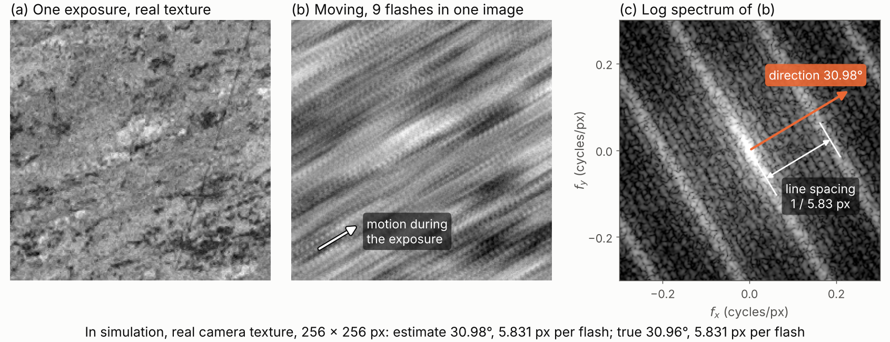

# Surface velocity from averaged camera frames

2-D FFT and Radon transform, Python and MATLAB/Octave. The same code also analyses a single multi-flash image.

[](https://github.com/onewmann/2D-FFT-Code/actions/workflows/ci.yml)

A camera takes K frames (9 by default) at a fixed frame rate while a textured surface moves past it, and the mean of these frames shows the surface K times, shifted by the same step each time.
In the 2-D spectrum of the mean image the shifts become evenly spaced straight lines: their angle gives the direction of motion, their spacing the distance moved per frame.
A strobe that flashes K times during one exposure gives the same image in a single frame, which is the setting of the thesis the method comes from: contactless measurement of a vehicle's speed over ground.
The estimator works in simulation, on synthetic frame sequences and on a first real recording, a hand-held phone video at 120 frames per second, where it agrees with phase correlation of the separate frames; a test against a known physical speed is still to come.



*In simulation: the mean of 9 frames in (b) holds 9 shifted copies of the surface, and they turn into the lines in (c), perpendicular to the motion and 1/5.83 cycles per px apart.*

## Status

| Area | State |
|---|---|
| Simulation and synthetic sequences | Works. In simulation (256 px, 9 frames with short exposures, no noise) the direction is within 0.70 deg and the speed within 0.47 % from 0.4 to 64 px per frame. On the two synthetic test sequences with constant motion (whole-pixel steps) all 24 windows of 9 averaged frames are valid. |
| Real camera, averaged frames | Works on a first real recording: a phone moved by hand over a desk top at 120 frames per second, 5.3 to 13.7 px per frame. All 68 windows of 5 frames with even steps are valid and within 0.81 % and 0.52 deg of phase correlation of the same frames (median 0.21 % and 0.13 deg) ([phone video](data/measurements/2026-10-16_phone_120fps/README.md)). There is no physical reference speed and no recording of the stopped surface yet. The 2025 Basler recordings, with steps that vary by a factor of 2.8 to 4.0, are rejected, as they should be. |
| Real multi-flash images | None yet. |
| Camera scripts | Experimental. Neither live script has run on camera hardware; the Python one was checked with the pylon camera emulator. |
| Tests | CI on every push: the Python tests on Python 3.10, 3.13 and 3.14, and the MATLAB/Octave tests, parity cases included, in GNU Octave and in MATLAB. Both jobs also run the two demos. |

## Who did what

The method comes from Jan Horn's doctoral thesis of 2006 ([reference](#reference)): the pulsed-exposure model, the log spectrum and Radon transform, the ripple profile WR for the direction, the speed from the spacing of the repeated structures and the quality measure GEBA. The 2025 scripts call the ripple profile Welligkeitsprofil and expand GEBA as Güte der Einzelbild-Analyse (quality of the single-image analysis).

In a student project in 2025 I implemented the method in MATLAB. Those scripts are kept at the tag [`student-project-2025`](https://github.com/onewmann/2D-FFT-Code/tree/student-project-2025/2D-FFT), unchanged apart from three edits: the repository template README was removed, and the location data of one photo and a folder path of my computer in one script were taken out ([details](docs/history.md#what-the-tag-holds)).

The rework, in 2026, is everything after that tag, done with the assistance of AI (Claude by Anthropic): first a code review of the 2025 scripts, then the code in `python/` and `matlab/`, the tests, the experiments, the figures and this documentation. In this README "rework" means that code, and the label [rework] marks what it added to the method of the thesis. [docs/history.md](docs/history.md) lists what the review found and compares the 2025 code with the rework.

I noticed errors in the results of my 2025 scripts and rebuilt the project with AI-assisted development, using Claude as a tool. I set the goals, asked for reviews of the old and the new code, and decided what to change and how to structure the repository; Claude wrote most of the new code, tests and documentation. Changes were checked with the tests in Python and GNU Octave and in separate reviews, and fixes from the reviews followed in later commits. Part of the aim is to show how I use AI in engineering work: with clear requirements, tests, reviews and documented limits, instead of accepting generated code unchecked.

## Quick start

From a clone of this repository, with Python 3.10 or newer (the editable install needs pip 21.3 or newer, hence the first line):

```bash
python -m pip install --upgrade pip
python -m pip install -e "./python[plot,data]"
python -m fftvel estimate data/measurements/synthetic_average/moving_regular.npz --stack --exposures 9 --duty 0.1 --gsd 0.05 --period 0.005
python -m fftvel simulate --exposures 9 --vx 5 --vy -3 --plot estimate.png
```

The third line averages a synthetic burst of 9 frames (192 x 192 px, 6 px per frame at 30 deg, 5 ms between frames and 0.5 ms exposure, so duty 0.1) and writes the estimate as JSON: 60.05 mm/s at 30.06 deg, valid, for a set speed of 60 mm/s. The last line simulates the mean of 9 frames of a 256 x 256 px texture moving by (5, -3) px per frame, prints the true velocity and the estimate and saves the diagnostic figure. The extras `plot` and `data` add matplotlib, SciPy, h5py and Pillow; [python/README.md](python/README.md) lists all extras. A whole session of bursts with controls goes through `experiments/real_measurements.py` ([your own measurements](#your-own-measurements)). In MATLAB or GNU Octave, from the repository root and without any toolbox:

```matlab
addpath('matlab');
[~, frames] = fftvel.simulate_pulsed_image(256, [5 -3], 4);   % 9 frames (L = 4, K = 2L+1) of a moving texture
[bp, K] = fftvel.pulsed_from_stack(frames);                   % their mean, K = 9
est = fftvel.estimate_velocity(bp, 'Exposures', K)
```

## Averaged frames, phase correlation and multi-flash images

The mean of the frames discards their order. If you have the separate frames and they overlap, phase correlation of consecutive frames (the shift between two images from the phase of their cross-power spectrum) is more accurate, and it also gives the sign of the motion, which the mean image cannot: its spectrum is the same for $\mathbf v$ and $-\mathbf v$. On the 840 images of the noise study (120 of them without noise), in simulation:

| Method | Input | Correct, random texture | Correct, camera texture |
|---|---|---:|---:|
| this method (`fftvel`) | one image: the mean of 9 frames, or 9 flashes | 80.2 % | 63.3 % |
| cepstrum / autocorrelation | the same image | 69.5 % / 72.1 % | 59.8 % / 55.0 % |
| phase correlation | two consecutive frames | 95.0 % | 87.9 % |

"Correct" means a direction within 2 deg and a speed within 5 %. On the random texture `fftvel` is correct more often than each single-image baseline (exact McNemar test on the same images, p < 0.001). On the camera texture its lead over the cepstrum is not significant (p = 0.09) and comes from the 60 images without noise; on the 360 noisy ones the cepstrum is correct in 208, `fftvel` in 206. Only `fftvel` also marks its results as valid or not. [results.md](docs/results.md#baselines) has the results per speed and the 2025 peak-spacing rule in corrected form.

Averaging the frames is still useful, for four reasons:

* It tests the multi-exposure method of the thesis with an ordinary camera under continuous light. The mean of K frames taken at equal steps with short exposures is the same image as K short flashes in one exposure, so the estimator meets a real lens, texture and sensor without a flash controller.
* One averaged image carries all K frames. A camera or frame grabber that sums or averages the frames before the transfer sends one image instead of K, which cuts the data to transfer and store by up to a factor of K (a sum needs a few more bits per pixel than one frame). The separate frames are then lost, and with them the step check described next.
* The estimator checks its own result. An estimate is valid only if the fit quality reaches a threshold calibrated on images without motion, the speed lies inside the measurable range and the spectrum is not isotropic. None of 2268 simulated images without motion was valid, but these are the images the threshold constant was checked on; on single real camera frames, which hold no repeated copies, 59 of 1360 crops were, and 41 of the 47 on the moving surface look like motion blur ([results.md](docs/results.md#single-camera-frames-a-real-null-test)). Phase correlation as used here has no calibrated check of this kind. Because the frames are kept, phase correlation of consecutive frames also checks that the steps are equal and gives an independent reference for every window, and `experiments/real_measurements.py` reports both next to the estimate.
* The same code also analyses a single multi-flash image, where separate frames cannot be tracked at all.

A camera that takes separate frames measures motion against the frame interval, 10 ms at 100 frames per second. A multi-flash image measures it against the flash period, which a controller can set in microseconds. Take a vehicle at 30 m/s, a ground sample distance (the length on the surface that one pixel covers) of 0.2 mm/px and a 256 px field, 51.2 mm wide. At 100 frames per second two consecutive frames are 300 mm apart and share no content, so neither phase correlation nor the mean of the frames measures the motion; frames 20 px apart would need 7500 frames per second. Flashes 133 µs apart give 20 px per flash inside one exposure, well within the 0.4 to 64 px per step tested for a 256 px square. This is the setting of the thesis. No real multi-flash image has been recorded for this repository yet.

## How it works

The thesis and the function names (`simulate_pulsed_image`, `pulsed_from_stack`) call the analysed image a pulsed-exposure image, and the option `exposures` counts its K exposures: the averaged frames, or the flashes of a multi-flash image.

Between two consecutive frames (or flashes) the surface moves by the step $\mathbf v$ pixels. The image is the mean of $K$ shifted copies of the texture $b$, so its spectrum is the spectrum $B$ of the texture times a Dirichlet kernel $D$:

$$B_p(\mathbf f) = B(\mathbf f)\,D(\mathbf f\cdot\mathbf v),\qquad D(u) = \frac{\sin(K\pi u)}{K\sin(\pi u)}$$

The magnitude of $D$ is 1 wherever $\mathbf f\cdot\mathbf v$ is an integer, so the magnitude spectrum carries straight lines perpendicular to $\mathbf v$, spaced $1/|\mathbf v|$ cycles per pixel apart. The estimator finds them in four steps:

1. Spectrum. The image is multiplied by a 2-D Hann window and its FFT zero padded to twice the size. [thesis] The estimator works on the logarithm of the magnitude, which turns the product $B\cdot D$ into a sum. [rework] A non-square image is cropped to a central square, never resized, so both axes keep the camera's pixel scale.
2. Direction [thesis]. A Radon transform projects the log spectrum along parallel projection paths for every angle. Along the direction of motion the projection becomes a sharp comb, and the ripple profile WR (the sum of absolute differences between neighbouring bins of a projection) peaks there. The thesis's quality measure GEBA $= \max WR/\mathrm{mean}\,WR$ is reported. [rework] The projection averages along each path instead of summing, which removes a bias towards 45 and 135 deg.
3. Speed [rework]. The thesis takes the speed from the spacing of the repeated structures. The rework fits a closed-form model of the whole projection for $K$ equal steps, including the autocorrelation of the Hann window, on a grid of speeds 0.5 % apart. The speed with the best correlation wins, and that correlation is the fit quality.
4. Validity [rework]. An estimate is valid if the fit quality reaches $\max\big(0.6,\ \tanh(9/\sqrt{m-5})\big)$ for a profile of $m$ independent points, the speed lies inside the measurable range (`in_range`) and the spectrum is not isotropic, as it is for defocus or a square repeating texture.

The options `exposures`, `duty` (the exposure over the frame interval, or the flash duration over the flash period), `roi`, `clip_outliers` and `reject_blur` come from the rework as well. [docs/method.md](docs/method.md) gives the full model, the threshold calibration, all options and the 33 constants.

## Results

Ordered by how independent the data are of the estimator's own model. All numbers come from `experiments/results/*.csv`.

| Study | Data | Result |
|---|---|---|
| [Phone video at 120 frames per second](docs/results.md#phone-video-at-120-frames-per-second) | 447 real frames of a phone moved by hand over a desk top; windows of 5 frames averaged; reference: the mean step between the same frames by phase correlation | 68 of 68 windows with even steps valid, speed within 0.81 % (median 0.21 %), direction within 0.52 deg; the 21 windows with uneven steps (dropped frames, changing motion) are flagged |
| [Synthetic test sequences](docs/results.md#synthetic-test-sequences) | 4 sequences from the 2025 student project, made without `fftvel`; windows of 9 frames averaged | Constant motion (whole-pixel steps): 24 of 24 windows valid, 134.93 to 135.03 deg (true 135), speed within 0.005 px. Changing speed: 17 of 22 valid, errors up to 11.1 %. Irregular steps: 4 of 22 valid, errors up to 14.4 % |
| [2025 recordings](docs/results.md#the-2025-recordings) | 3 Basler frame sequences of a moving surface, two 9-frame averages each | Steps vary by a factor of 2.8 to 4.0 within a recording; all 6 windows rejected (quality 0.23 to 0.40, threshold 0.6) |
| [Single camera frames](docs/results.md#single-camera-frames-a-real-null-test) | 1360 crops of single frames of the 2025 recordings: one exposure each, so nothing repeats | 59 valid, all false alarms; 41 of the 47 on the moving surface look like motion blur |
| [Accuracy](docs/results.md#accuracy-and-noise-in-simulation) | in simulation: 256 px, 9 frames with short exposures, no noise, random and camera texture | Within 0.70 deg and 0.47 % from 0.4 to 64 px per frame; 0 of 24 valid at 0.3 px per frame, below the range |
| [Noise](docs/results.md#accuracy-and-noise-in-simulation) | in simulation: 60 images per noise level and texture | Noise at half the signal: 91.7 % correct (random texture) and 70.0 % (camera texture); noise as strong as the signal: 71.7 % and 50.0 %. 11 of 592 valid estimates wrong; 0 of 120 images without motion valid |
| [Baselines](docs/results.md#baselines) | in simulation: the 840 noise images | Correct (random / camera texture): `fftvel` 80.2 / 63.3 %, single-image baselines at most 72.1 / 59.8 % (on the camera texture not significantly different from the cepstrum), phase correlation of two frames 95.0 / 87.9 % |

The simulated images come from the model the estimator fits: the mean of K instantaneous exposures, which is the mean of K frames with short exposures and equally one exposure with K short flashes. They check the implementation and say nothing about how well that model describes a real camera. Most numbers in the next section come from an independent forward model, which does not use the estimator's simulator and adds sensor noise, long exposures, timing and brightness jitter and other violations of the model ([results.md](docs/results.md#model-violations-in-an-independent-forward-model)).

## Where it fails

All numbers are in simulation unless the row says otherwise. The shares from the forward model are of 32 images per level, so one image is 3.1 percentage points, and 4 of 32 (12.5 %) has a 95 % confidence interval of 5.0 to 28.1 % (Wilson). The forward model renders flashes; for averaged frames the exposure of a frame takes the place of a flash and the frame interval the place of the flash period.

### Wrong but marked valid

These causes give a wrong result that is still marked valid by the estimator alone.

| Cause | What happens | Remedy |
|---|---|---|
| Uneven frame steps, dropped frames | intervals alternating between 0.8 and 1.2 periods: 87 of 240 valid at twice the speed; one frame missing: 22 of 240 valid but wrong; test sequence with irregular steps (`vehicle`): 4 of 22 windows valid, errors up to 14.4 %. Strongly uneven real steps are rejected: the 2025 recordings, with steps varying by a factor of 2.8 to 4.0, gave 0 of 6 windows valid | a fixed frame rate and enough buffers; the frame-interval check of the live scripts and the step check of `real_measurements.py` flag such windows ([camera settings](docs/acquisition.md#camera-settings)) |
| Exposure too long, `duty` not set | exposures of 0.25 and 0.5 of the frame interval: 12.5 % and 18.8 % wrong but valid, speed near duty x speed / K | an exposure of at most a quarter of the frame interval, and `duty` / `--duty` (the column `exposure_s` in `meta.csv`; the live scripts read the exposure from a Basler camera); with the true duty all images were correct and valid ([camera settings](docs/acquisition.md#camera-settings)) |
| Changing speed | test sequence with changing speed (`accelerating`): 17 of 22 windows valid, errors up to 11.1 % | constant speed during the K frames; the step check flags windows whose steps spread by more than 10 % ([reference speed](docs/acquisition.md#reference-speed)) |
| Strong static edges | an edge of twice the mean signal: 28.1 % wrong but valid | keep edges and masks out of the analysed square (`roi`), fill masked areas with the image mean ([edges](docs/acquisition.md#saturation-and-glints)) |
| Glints, saturated spots | two static glints of 3 times the mean signal: 96.9 % wrong but valid | `clip_outliers`, with which all were correct and valid; diffuse light, no saturated pixels ([glints](docs/acquisition.md#saturation-and-glints)) |
| Periodic texture | a pattern repeating every 64 or 128 px: 100 % wrong but valid; every 160 px: 50.0 % | a non-repeating texture ([assumptions](docs/method.md#assumptions)) |
| Wrong K | 7, 8, 10 or 11 assumed for 9: 34.4 % wrong but valid, speed scaled by 9/K | the number of averaged frames as `exposures` / `--exposures`; `pulsed_from_stack` returns it, and `real_measurements.py` takes it from the column `frames` |

### Marked not valid

These causes are flagged as not valid in most cases.

| Cause | What happens | Remedy |
|---|---|---|
| Flicker, frames of unequal brightness | not simulated as such; random energy differences between the exposures, with a standard deviation of 20 and 40 %, gave 93.8 and 84.4 % correct and valid and none wrong but valid. Periodic flicker from mains lamps may behave differently | continuous light without flicker, for example LEDs on a DC supply ([camera settings](docs/acquisition.md#camera-settings)) |
| Motion below the measurable range, about 3.35/K px per frame | 0 of 24 valid at 0.3 px per frame with 9 frames | a lower frame rate or more frames ([frame rate](docs/acquisition.md#choosing-the-frame-rate)) |
| Heavy noise | camera texture with noise as strong as the signal: 50.0 % correct, 50.0 % valid; over all noise levels 11 of 592 valid estimates wrong | more light, more pixels per frame ([frame rate](docs/acquisition.md#choosing-the-frame-rate)) |
| No texture or no motion | 0 of 120 images without motion valid, and 0 of 2268 simulated ones in the threshold calibration; real single-frame crops of a room scene (`vid1`): 4 of 252 valid | keep saturated areas out of the image ([glints](docs/acquisition.md#saturation-and-glints)) |
| Defocus | the isotropy check rejects the ring pattern of a static defocused surface; with sensor noise, correct and valid falls from 84.4 % in focus to 40.6 % at a blur radius of 2 px | focus at the working distance ([focus](docs/acquisition.md#focus)) |

### Multi-flash images

In a single multi-flash image the duty, the count K and the intervals concern the flashes, and light other than the flashes becomes a cause as well; all of these gave wrong results marked valid. Unlike the frames of a burst, the image itself offers no check of the timing.

| Cause | What happens | Remedy |
|---|---|---|
| Long flashes, `duty` not set | flashes of 0.25 and 0.5 of the period: 12.5 % and 18.8 % wrong but valid, as for long exposures above | short flashes, or `duty` / `--duty` ([duty](docs/acquisition.md#flash-duration-and-duty)) |
| Wrong flash count | an image with 7, 8, 10 or 11 flashes estimated as 9: 34.4 to 37.5 % wrong but valid | the exact K with `exposures` / `--exposures`; count the pulses once with a photodiode ([flash count](docs/acquisition.md#the-exact-flash-count)) |
| Continuous light, or motion blur at slow speed | real single frames of the moving surface: 47 of 1020 crops valid, 41 of them blur-like. Continuous light for 3/4 of the signal: 34.4 % wrong but valid | dark enclosure or band-pass filter, control images with one flash; `reject_blur`, which costs correct results below about 2.2 px per step ([ambient light](docs/acquisition.md#ambient-light)) |
| Uneven flash intervals, flash jitter | a missing flash or alternating intervals as for frames above; random jitter of 10 % of the period: 9.4 % wrong but valid | flashes from a hardware timer, period checked with a photodiode ([flash count](docs/acquisition.md#the-exact-flash-count)) |

The direction is known only modulo 180 deg: one image cannot tell $\mathbf v$ from $-\mathbf v$. With averaged frames the sign comes from phase correlation of consecutive frames, which `real_measurements.py` reports as the mean step (`step_dx_px`, `step_dy_px`).

## Usage

### Python

The options after the image are keyword-only ([options](docs/method.md#options-and-when-to-use-them)).

```python
import fftvel
from fftvel.io import load

frames = load("data/measurements/synthetic_average/moving_regular.npz", stack=True)   # 192 x 192 x 9, uint8
bp, K = fftvel.pulsed_from_stack(frames, exposures=9)   # mean of the first 9 frames of the stack
est = fftvel.estimate_velocity(bp, exposures=K, duty=0.1, diagnostics=True)   # 0.5 ms exposure / 5 ms frame interval
print(est.angle_deg, est.speed, est.quality, est.valid)
p = fftvel.to_physical(est, gsd=0.05, period=0.005)    # 0.05 mm per px, 5 ms between frames
print(p.speed)                                          # mm/s
fftvel.plot_estimate(bp, est).savefig("estimate.png")   # needs matplotlib and diagnostics=True

bp = fftvel.simulate_pulsed_image(256, (5, -3), 4)     # L = 4, so K = 2L+1 = 9; 5 px right, 3 px up per step
est = fftvel.estimate_velocity(bp, exposures=9)
```

`fftvel.pulsed_from_stack` averages consecutive frames into one image; the synthetic burst above moves 6 px per frame at 30 deg and gives 6.00 px at 30.1 deg, valid, and 60.05 mm/s for a set 60 mm/s. `fftvel.io.load` is the file reader of the command line and reads the same formats. A multi-flash image goes to `estimate_velocity` as it is, with its flash count, and `period` is then the flash period: `fftvel.estimate_velocity(load("data/measurements/synthetic_flash/flash_a.png"), exposures=9, duty=0.02)` gives 4.00 px per flash, 200.11 mm/s with `gsd=0.05, period=0.001`.

### Command line

The command line reads PNG, TIFF, BMP, `.npy`, `.npz` and `.mat` files, writes the result as JSON to stdout and notes on what it read to stderr. `--stack` averages the first K frames of a stack (`--exposures K`; without it all frames, if their number is odd). With `--gsd` (length per pixel) and `--period` (seconds between frames) the JSON also holds `speed_per_s`, `vx_per_s` and `vy_per_s`: 60.05 mm/s for this synthetic burst, made with 60 mm/s.

```bash
python -m fftvel estimate data/measurements/synthetic_average/moving_regular.npz --stack --exposures 9 --duty 0.1 --gsd 0.05 --period 0.005
```

A single multi-flash image needs the flash count, `--exposures K` (or `--L L` for K = 2L+1), and `--period` is then the time between flashes: 200.11 mm/s for this synthetic image, made with 200 mm/s.

```bash
python -m fftvel estimate data/measurements/synthetic_flash/flash_a.png --exposures 9 --duty 0.02 --gsd 0.05 --period 0.001
```

Further options are `--roi` (side of the analysed square, default 512 px), `--clip-outliers`, `--frames-axis` and `--plot`; `python -m fftvel estimate --help` lists them all, and [python/README.md](python/README.md) explains the install extras.

### MATLAB and GNU Octave

An estimate from simulated frames, from the repository root and without any toolbox; with the Image Acquisition Toolbox, `frames = getdata(vid, 9)` gives real ones:

```matlab
addpath('matlab')                                        % the folder that holds +fftvel
[~, frames] = fftvel.simulate_pulsed_image(256, [5 -3], 4);   % 9 frames, 5 px right and 3 px up per frame
[bp, K] = fftvel.pulsed_from_stack(frames);              % their mean, K = 9
est = fftvel.estimate_velocity(bp, 'Exposures', K, 'Diagnostics', true);
p = fftvel.to_physical(est, 0.05, 1/80);                 % GSD 0.05 mm per px, then 1/80 s between frames
fprintf('%.1f mm/s at %.1f deg, valid %d\n', p.speed, est.angle_deg, est.valid);
fftvel.plot_estimate(bp, est, frames(:, :, 5));
```

A multi-flash image goes in as it is, with its flash count:

```matlab
bp = double(imread('data/measurements/synthetic_flash/flash_a.png'));
est = fftvel.estimate_velocity(bp, 'Exposures', 9, 'Duty', 0.02);
p = fftvel.to_physical(est, 0.05, 1e-3);                 % GSD 0.05 mm per px, then 1 ms between flashes
```

The functions and options have the same names as in Python. Give the options as name-value pairs, `'Duty', 0.02`: MATLAB R2021a and newer also accept `Duty=0.02`, but GNU Octave does not, because it reads that as an assignment and passes only the value. `to_physical` takes the GSD and then the frame interval or flash period by position. `help fftvel.Contents` lists the functions.

### Live camera scripts

The live scripts are experimental. [`python/examples/live_camera.py`](python/examples/live_camera.py) streams from a Basler camera through pypylon or from a webcam or video file through OpenCV, [`matlab/examples/live_basler.m`](matlab/examples/live_basler.m) from a Basler camera through the Image Acquisition Toolbox. Neither has run on camera hardware. The Python script was checked with the pylon camera emulator and is tested with fake camera modules; `live_basler.m` has not run in MATLAB. Their average mode grabs K consecutive frames under continuous light, checks that the frame intervals are equal, estimates the mean and, with `--save` (`'SaveDir'`), writes every burst for `real_measurements.py`; their flash mode estimates every multi-flash frame on its own. At the default 512 px square one estimate takes about 4 s in Python ([live scripts](docs/acquisition.md#live-scripts)).

```bash
python python/examples/live_camera.py --mode average --source pylon --exposures 9 --frame-rate 80 --exposure-us 2000
python python/examples/live_camera.py --mode flash --source pylon --exposures 9 --flash-period 0.0005 --duty 0.04
```

```matlab
addpath('matlab', 'matlab/examples')
live_basler('Mode', 'average', 'Exposures', 9, 'FrameRate', 80, 'ExposureUs', 2000)
live_basler('Mode', 'flash', 'Exposures', 9, 'FlashPeriod', 5e-4, 'Duty', 0.04)
```

### Your own measurements

To evaluate your own measurements, list the frame bursts in a `meta.csv` with mode `average`, the number of frames, the frame period, the exposure, the ground sample distance and the set speed and direction, and add bursts of the stopped surface as controls; the live scripts write such a folder. Multi-flash images take the flash count, flash period and duty instead. [`data/measurements/README.md`](data/measurements/README.md) describes the format, [docs/acquisition.md](docs/acquisition.md) what the set-up needs and which controls to record. On the synthetic burst example the tool marks both moving windows valid with speed errors below 0.1 %, flags the one with a dropped frame through its step check and marks the static one not valid; on the multi-flash example both moving images are valid with speed errors below 0.06 % and the static image is not valid:

```bash
python experiments/real_measurements.py data/measurements/synthetic_average/meta.csv --out results.csv
python experiments/real_measurements.py data/measurements/synthetic_flash/meta.csv --out results.csv
```

## Development

```bash
python -m pip install -e "./python[test]"
python -m pytest -q tests/python
cd tests/matlab && octave --no-gui --eval run_tests
```

With MATLAB, from the repository root:

```bash
matlab -batch "cd tests/matlab; run_tests"
```

The tests check the implementation: known motion in simulation and on the test sequences, rejection of images without motion, every option and its argument checks, and parity, which means that the Python and MATLAB/Octave packages give the same results to 1e-9 on 20 shared cases (checked in GNU Octave and in MATLAB). They do not show that the model holds for a given camera; that takes real recordings, frame bursts at a fixed frame rate or multi-flash images. Because the two languages are compared case by case, Python and MATLAB change together; [CONTRIBUTING.md](CONTRIBUTING.md) lists the steps.

```
python/src/fftvel/   Python package; python -m fftvel is the command line, fftvel.io reads files, phasecorr.py holds phase_correlation
python/examples/     demos and the live camera script
matlab/+fftvel/      MATLAB/Octave package (help fftvel.Contents), helpers in +internal/; matlab/examples/ the same demos and live_basler.m
tests/               both test suites, the parity cases and constants.json
experiments/         one script per study (run.py runs them) and real_measurements.py, the evaluation of your own measurements; results/ holds the CSV files
data/                test sequences, a camera texture, the 2025 recordings; measurements/ for your own sessions and two synthetic examples
docs/                method.md, results.md, acquisition.md, history.md; figures/
```

A full clone is about 130 MB, because the history also holds the files of the 2025 student project. A partial clone fetches only the files of the version you check out (about 70 MB, most of it the four recordings in `data/recordings/`) and older files when they are needed:

```bash
git clone --filter=blob:none https://github.com/onewmann/2D-FFT-Code
```

## Reference

Jan Horn: *Zweidimensionale Geschwindigkeitsmessung texturierter Oberflächen mit flächenhaften bildgebenden Sensoren* (two-dimensional velocity measurement of textured surfaces with area image sensors). Doctoral thesis, Universität Karlsruhe (TH), 2006. Schriftenreihe des Instituts für Mess- und Regelungstechnik, Band 006, Universitätsverlag Karlsruhe, 2007. ISBN 978-3-86644-076-0. [Full text (CC BY-NC-ND 2.0 DE)](https://publikationen.bibliothek.kit.edu/1000006276)

## Citation and licence

[CITATION.cff](CITATION.cff) holds the citation of this code, and GitHub offers it under "Cite this repository". For the method, cite the thesis above. The code is under the MIT licence, see [LICENSE](LICENSE). The data files in `data/` (the test sequences, the camera texture, the 2025 recordings, the phone video and the synthetic measurement examples) are under CC BY 4.0; [data/README.md](data/README.md#licence-of-the-data) says what each file is and who made it.
