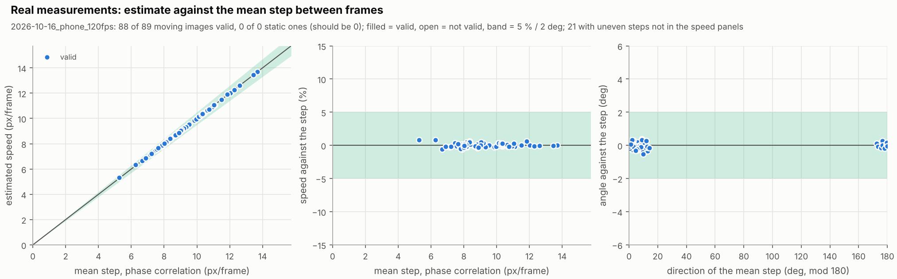

# Phone video at 120 frames per second

The first real recording that the estimator measures: a phone moved by hand
over the speckled top of a desk, recorded in slow motion at 120 frames per
second with the phone's lamp on, 3.9 s, 447 frames. Windows of 5
consecutive frames are averaged (mode average) and estimated, and each
estimate is compared with the mean step between the same frames by phase
correlation. Data and figure are under CC BY 4.0
([licence of the data](../../README.md#licence-of-the-data)).

| File | What |
|---|---|
| `desk_120fps.mp4` | the video as recorded (HEVC, 1080 x 1920 px upright); only the sound track and the file metadata were removed, the video stream is unchanged |
| `extract_frames.py` | writes `frames.npz` (a 512 x 512 px square of every frame, grey, with the timestamps) and `meta.csv` |
| `meta.csv` | 89 consecutive windows of 5 frames |
| `results.csv`, `results.png` | the output of `experiments/real_measurements.py` |

```bash
python -m pip install -e "./python[plot,data,video]"
python data/measurements/2026-10-16_phone_120fps/extract_frames.py
python experiments/real_measurements.py data/measurements/2026-10-16_phone_120fps/meta.csv --figure data/measurements/2026-10-16_phone_120fps/results.png
```

The analysed square lies below the bright spot of the lamp, which stays at
the same place in the image while the surface moves; a static bright spot in
the square breaks the model (assumption 9 in
[method.md](../../docs/method.md#assumptions)). `frames.npz` is not in git
(75 MB); the script makes it from the video in a few seconds.

## Recording

The frame interval is 8.32 ms (median of the timestamps stored in the video).
There is a gap of 178 ms after the first frame, as the phone starts recording,
and four gaps of 25 ms, three frame intervals, where the phone dropped two
frames. Between consecutive frames the surface moved by about 1.5 to 14.3 px
(5.3 to 13.7 px in the 68 windows with even steps), close to horizontal
(directions of -11 to 15 deg between frames, -7 to 14 deg in those windows). The exposure time is not stored, so the duty is
taken as 0. Nothing was saturated.

## Result



| | Windows | Valid |
|---|---:|---:|
| Even steps (the step check passes) | 68 | 68 |
| Uneven steps (a gap in the timestamps, or steps that spread by more than 10 % or 5 deg) | 21 | 20 |

For the 68 windows with even steps, the estimate against the mean step:

| | Median | 95th percentile | Max |
|---|---:|---:|---:|
| Speed, \|est/step - 1\| | 0.21 % | 0.61 % | 0.81 % |
| Direction | 0.13 deg | 0.34 deg | 0.52 deg |

None of the 68 is off by more than 5 % or 2 deg (one-sided 95 %
Clopper-Pearson upper bound of the rate: 4.3 %; the windows come from one
recording of one surface and are not independent).

The window that is not valid is the first one, which holds the start gap.
Four of the valid windows with uneven steps hold one of the 25 ms gaps; their
estimates are 32 to 34 % below the mean step, because one of their four steps
is three times as long. Their estimates agree within 0.7 % with the median of
the steps, the regular step between the other frames. A fifth window has steps
that spread by 23 % and is 2.3 deg off. By the exclusion rule of
[acquisition.md](../../docs/acquisition.md#first-recording-step-by-step) all
21 windows with uneven steps are left out of the numbers above.

## What this shows, and what not

It shows that the estimator finds the motion of a real camera over a real
surface, with lens, sensor noise, video compression and hand-held motion, in
agreement with phase correlation of the separate frames, and that the step
check flags the windows where the frames are not evenly spaced.

It does not show:

* the speed in mm/s. The ground sample distance was not measured, and the
  phone moved at an unknown speed, so there is no physical reference;
* errors that the estimator and the reference share. Both use the same
  frames, so a scale error of the image (lens distortion, rolling shutter)
  affects both alike;
* the false-alarm rate. No recording of the phone lying still was made yet;
* other surfaces, lighting or phones. It is one recording of 3.9 s.

An earlier attempt with three videos at 30 frames per second (not in the
repository) failed for the reasons in
[acquisition.md](../../docs/acquisition.md#choosing-the-frame-rate): at
76 to 93 px per frame (median) and with the motion blur of a long exposure,
51 of 268 windows of 5 frames were valid.
