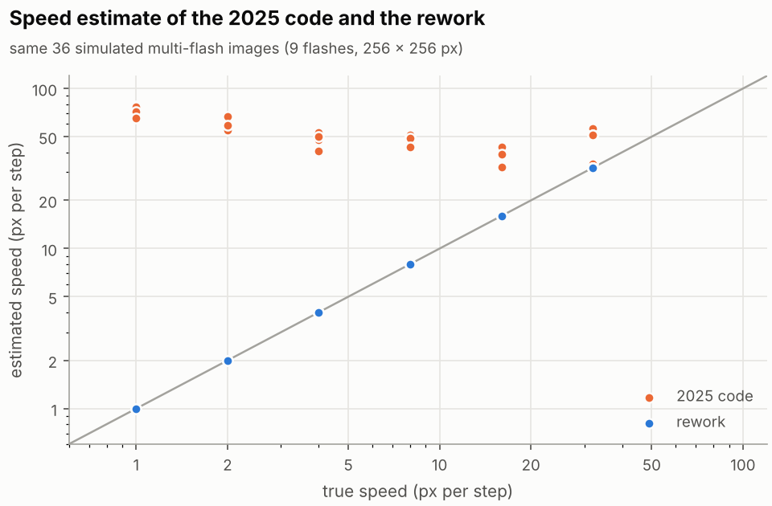

# History of the code

The method comes from the doctoral thesis of Jan Horn (2006; full reference in
[method.md](method.md#reference)). A student project in 2025 implemented it in
MATLAB. Its scripts are kept at the tag
[`student-project-2025`](https://github.com/onewmann/2D-FFT-Code/tree/student-project-2025/2D-FFT),
unchanged apart from the repository template README. Everything after the tag
was done with the assistance of AI (Claude by Anthropic): first a code review
of the 2025 scripts, then the rework, starting with the commit "Rewrite the
2D-FFT velocity estimator for MATLAB, Octave and Python". On this page and in
the figures, "2025 code" means the scripts at the tag and "rework" the code
that followed them in this repository.

This page lists what the review found in the 2025 scripts, what the rework
changed, and compares the 2025 code with the rework on the same images. After
that comes an inventory of the files at the tag: what they hold, an index of
the scripts by function, their file names and headers, and their duplicates.
The current method is described in [method.md](method.md), its results in
[results.md](results.md), and what an acquisition needs in
[acquisition.md](acquisition.md).

## What the review found

The code review of the 2025 scripts, the first step after the tag
`student-project-2025`, found three problems that decide whether a speed can
be right.

The speed came from peaks picked with a fixed prominence. The live GUI
`aktuell/finaltest1.m` takes the Radon projection of $\log(1+|B|)$ along the
direction found and calls `findpeaks(..., 'MinPeakProminence', 0.05,
'MinPeakDistance', 3)`; the speed is $2N$ divided by the mean spacing of the
peaks. MATLAB's `radon` sums along lines, so the projection values grow with
the image size, and an absolute prominence of 0.05 lets small ripples from
noise through. Extra peaks shorten the mean spacing and make the speed too
large. The same fixed value of 0.05 appears in `main.m` and
`studiprojekKapitel34_v2.m` (both copies of each), `G/finaltest1.m`,
`G/studiprojekKapitel34_v1.m`, `G/radon_video_gui_fixedspeed.m`,
`G/radon_video_gui_withnoise.m` and `G/test.m`.

Live frames were resized anisotropically. `aktuell/finaltest1.m` sets the
camera ROI to the full sensor and resizes every frame with
`imresize(I, [N N])`, N = 256. For a full frame of 1936 x 1216 px, the size of
the recordings, the horizontal scale is 0.132 and the vertical 0.211, a ratio
of 1.59. A motion at 45 deg on the sensor then appears at 57.9 deg, and the
speed is scaled by 0.132 to 0.211 depending on its direction, so neither
direction nor speed stays in camera pixels. The video GUIs and `G/test.m`
resize to N x N in the same way.

The recordings do not have equal steps. The scripts averaged consecutive
frames into a pulsed image, which needs the surface to move by the same step
between all of them. Phase correlation of consecutive frames of the three
recordings of the moving surface gives steps of 2.94 to 8.19 px (`vid2`), 4.53
to 17.99 px (`vid3`) and 1.60 to 6.01 px (`vid4`), with directions spread over
29 to 41 deg within a recording. All six 9-frame averages are rejected by the
rework ([results.md](results.md#the-2025-recordings)).


## What the rework changed

The rework keeps the parts of the method that come from the thesis (the
pulsed-exposure model, the log spectrum, the Radon transform, the ripple
profile WR and GEBA) and changes the implementation:

* the speed comes from a fit of a closed-form Dirichlet model, which includes
  the autocorrelation of the Hann window, instead of from counting peaks;
* the fit quality decides validity, with a threshold
  $\tanh(9/\sqrt{m-5})$ that depends on the image size, together with a range
  guard (`in_range`) and an isotropy check;
* the options `exposures`, `duty`, `roi`, `clip_outliers` and `reject_blur`;
* the Radon step averages along each line instead of summing;
* images are cropped to a square, never resized;
* simulations move a fixed window over a larger texture instead of shifting
  frames with zero fill;
* one implementation per language, Python and MATLAB/Octave, with parity
  tests and continuous integration, in place of 37 script files.

## Before and after

[`experiments/history/original_2025.py`](../experiments/history/original_2025.py)
ports the processing chain of `aktuell/finaltest1.m` to Python: top-hat
background removal, Wiener filter, Hann window, zero padding to $2N$,
$\log(1+|B|)$, MATLAB's `radon`, the maximum of WR for the direction, and
`findpeaks` with the fixed prominence for the speed.
[`experiments/history/before_after.py`](../experiments/history/before_after.py)
runs it and the rework on the same 36 simulated pulsed images (random
texture, 9 flashes, 256 x 256 px, no noise, speeds of 1, 2, 4, 8, 16 and 32 px
per flash in 6 directions).

| | 2025 code | Rework |
|---|---|---|
| Direction within 2 deg | 31 of 36 | 36 of 36 (largest error 0.049 deg) |
| Speeds reported | 32.1 to 78.1 px per flash, whatever the true speed | within 0.13 % of the true speed |
| Median speed error | 733 % | 0.018 % |
| Marked valid | (no validity check) | 36 of 36 |



In simulation, the 2025 code found the direction in most cases and took its
speed from noise peaks. The images come from the rework's own simulator, the
model the rework fits, so the table documents what changed in the code. It
says nothing about real images.

```bash
python experiments/history/before_after.py
```

## What the tag holds

The folder `2D-FFT/` at the tag holds 37 MATLAB files: 18 at its top level, 3
in `aktuell/` and 16 in `aktuell/Grundlagen_Skripte/`. Besides them there are
`aktuell/Grundlagen_Skripte/matlab.mat`, a `.gitignore` and a `data/` folder
with the test sequences (`Testsequenzen1.mat`), four Basler recordings
(`vid1.mat` to `vid4.mat`), one image (`image001.png`) and two videos
(`testvid.mp4`, `testvid1.mp4`). The recordings are byte-identical to
`data/recordings/` in the current tree, and `data/testsequences.mat` was
converted from `Testsequenzen1.mat` (see [`data/README.md`](../data/README.md)).

The first upload also contained `Matlab_BaslerCamDriver/`, a Basler camera
driver for MATLAB by another author under the MIT licence. It is third-party
code: the tag still holds it at the repository root, and the rework neither
contains nor uses it. The upload also held a repository template `README.md`
in `2D-FFT/`, which was removed from the tag; apart from that, the tag keeps
the 2025 scripts unchanged.

To read the files without checking out the tag:

```bash
git ls-tree -r --name-only student-project-2025 -- 2D-FFT
git show student-project-2025:2D-FFT/aktuell/finaltest1.m
```

## Index of the 2025 scripts by function

Paths are relative to `2D-FFT/`; `G/` stands for
`aktuell/Grundlagen_Skripte/`. The description follows the header comment of
each file. Where a name exists in two folders, both are listed; the section on
duplicates below says how far they differ.

### Image formation and simulation

| File | What its header describes |
|---|---|
| `studiprojekKapitel21_v3.m`, `G/` | image acquisition of a moving texture with constant and with pulsed exposure, simulated |
| `studiprojekKapitel33_v1.m`, `G/` | a static texture, a sequence of shifted copies and their mean as "software pulsing" (header: section 3.1.3) |
| `G/bilddarstellung.m` | image acquisition as a convolution of the texture with a motion kernel, and the product of their spectra |
| `simulateTexture.m`, `G/` | random texture: white noise through an exponential low-pass filter |
| `exponentialFilter.m`, `G/` | the isotropic exponential filter used by `simulateTexture.m` |
| `generateImageSequence.m`, `G/` | frames $`b(\mathbf x - \mathbf v(k-k_0))`$, shifted with `imtranslate` and zero fill |

### Single-image analysis

| File | What its header describes |
|---|---|
| `G/studiprojekKapitel34_v1.m` | magnitude and direction from a simulated pulsed image: log spectrum, Radon transform, ripple profile, peak spacing (header: section 3.2) |
| `studiprojekKapitel34_v1.m` | a similar analysis of the recording `vid4.mat`, with a 1-D FFT of the projection as a fallback for the speed |
| `G/studiprojekKapitel34_v2.m` | one image file (`data/image001.png`): background subtraction, denoising, contrast stretch, window, zero padding, Radon transform and sub-pixel peak fit |
| `main.m`, `G/` | sections 3.2 to 3.4 in one script: direction and magnitude, resolution reduction, GEBA |
| `untitled.m` | simulation, summation, spectrum, Radon transform, angle and magnitude, resolution reduction and quality measure in one script |

### Pixel reduction

| File | What its header describes |
|---|---|
| `studiprojekKapitel35_v1.m` | fewer pixels by a pyramid step (`imresize`) against a central crop, with images and spectra compared (header: section 3.3) |

### Quality measure GEBA

| File | What its header describes |
|---|---|
| `studiprojekKapitel34_v2.m` | GEBA and estimates of magnitude and angle (header: section 3.4) |
| `studiprojekKapitel36_v1.m`, `G/` | self-assessment ("Selbstbeurteilung") of the single-image analysis by GEBA (header: section 3.4) |
| `video_test.m` | GEBA $= \max WR/\mathrm{mean}\,WR$, with phase correlation as a comparison |

### Camera and live

| File | What its header describes |
|---|---|
| `aktuell/finaltest1.m` | live GUI for a Basler camera (GenTL, Mono8): angle and speed over time. Its processing chain is ported to [`experiments/history/original_2025.py`](../experiments/history/original_2025.py) |
| `G/finaltest1.m` | a longer version of the same GUI (227 lines against 196) |
| `kamera_live.m` | records 2L+1 webcam frames every 10 ms, then averaging, pixel reduction and FFT |
| `Chapter3_4_live.m`, `Chapter3_4_live_verbessert.m` | webcam capture with FFT, log spectrum, Radon transform, WR and GEBA; the second is a revised version with grey-scale frames |
| `camera3_feed_sample.m`, `G/` | webcam live view that keeps a frame on a key press |
| `Treiber_install.m`, `G/` | downloads and installs the `winvideo` and `gentl` adaptors of the Image Acquisition Toolbox |
| `show_images.m` | loads `vid2.mat` and shows two of its frames |

### Video GUIs

| File | What its header describes |
|---|---|
| `aktuell/radon_video_gui_withnoise.m` (328 lines), `G/radon_video_gui_withnoise.m` (206 lines) | Radon analysis of a video at a fixed playback speed, with optional noise in the image or in the projections |
| `G/radon_video_gui_fixedspeed.m` | the same without the noise option |
| `G/test.m` | single-image analysis of a video that uses every fifth frame |

### Unrelated

| File | What its header describes |
|---|---|
| `aktuell/polyphasen_filterbank.m` | visualisation of a polyphase analysis filter bank; no other script refers to it |

## File names and headers

The file names do not match their own headers. The number in a
`studiprojekKapitel` name and the section number in the header of the same file
disagree for four of the six such names: `studiprojekKapitel33_v1.m` is headed
3.1.3, `G/studiprojekKapitel34_v1.m` 3.2, `studiprojekKapitel35_v1.m` 3.3 and
`studiprojekKapitel36_v1.m` (in both folders) 3.4. The first comment line of
many scripts also names a different file:

| File | Name in its first comment line |
|---|---|
| `main.m` (both copies) | `masterAnalysis.m` |
| `untitled.m` | `main_single_image_analysis.m` |
| `video_test.m` | `Chapter3_4_GEBA.m` |
| `G/test.m` | `Chapter3_4_radon_video_subsample5.m` |
| `G/bilddarstellung.m` | `system_theory_image_acquisition_demo_commented.m` |
| `Treiber_install.m` (both copies) | `installIAAdapters.m` |
| `studiprojekKapitel33_v1.m` (both copies) | `Chapter3_1_3.m` |
| `studiprojekKapitel34_v1.m` | `single_frame_velocity_estimation.m` |
| `G/studiprojekKapitel34_v1.m` | `Chapter3_2.m` |
| `studiprojekKapitel34_v2.m` | `Chapter3_4_complete.m` |
| `G/studiprojekKapitel34_v2.m` | `Chapter3_4_preproc_radon_contrast_fullscript.m` |
| `studiprojekKapitel35_v1.m` | `Chapter3_3.m` |
| `studiprojekKapitel36_v1.m` | `Chapter3_4_complete_fixed.m` |
| `G/studiprojekKapitel36_v1.m` | `Chapter3_4_commented.m` |

Three function files define a function with another name:
`finaltest1.m` defines `live_radon_basler_gui_save_seconds`,
`camera3_feed_sample.m` defines `camera3_feed_sample_10ms`, and
`Chapter3_4_live_verbessert.m` defines `Chapter3_4_live`, the same name as the
file next to it. MATLAB calls a function file by its file name, so the
scripts still run.

## Duplicates

Eleven names exist both at the top level and in `G/`. Compared with
`diff -w --strip-trailing-cr`, which ignores white space and line endings:

* five are the same: `exponentialFilter.m` (byte-identical),
  `Treiber_install.m`, `camera3_feed_sample.m`, `generateImageSequence.m` and
  `simulateTexture.m`;
* three differ in a few lines: `main.m` (L = 3 against 20, angles 0 to 179
  against 0 to 359 deg), `studiprojekKapitel21_v3.m` (the author and date
  lines) and `studiprojekKapitel33_v1.m` (the author and date lines and blank
  lines);
* three are different scripts under the same name:
  `studiprojekKapitel34_v1.m` (265 lines against 132),
  `studiprojekKapitel34_v2.m` (139 against 159) and
  `studiprojekKapitel36_v1.m` (236 against 280).

Two further names exist in `aktuell/` and in `G/`: `finaltest1.m` (31 lines
differ) and `radon_video_gui_withnoise.m` (142 lines differ).
