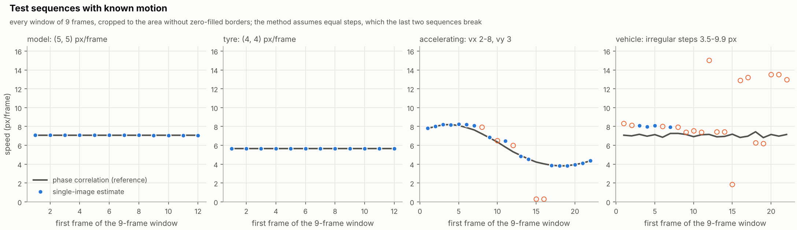
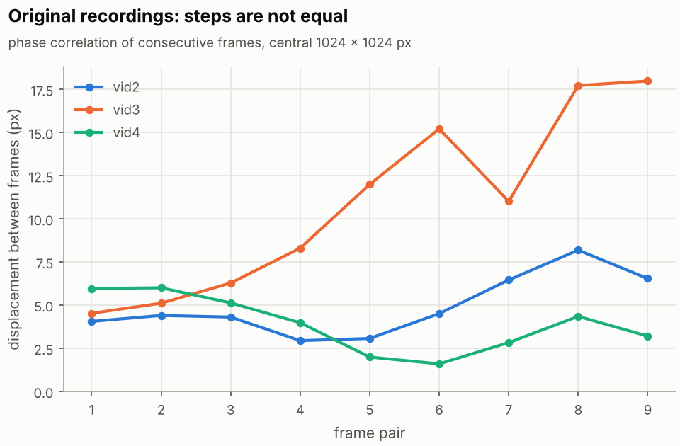
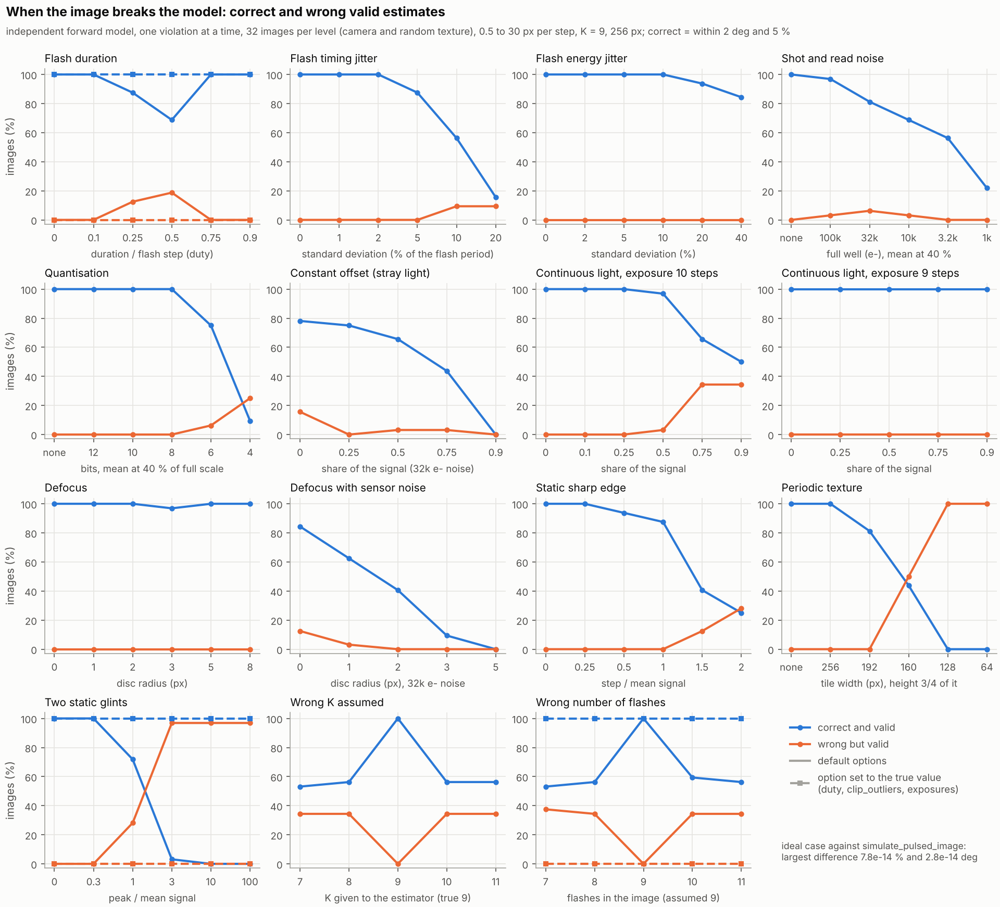
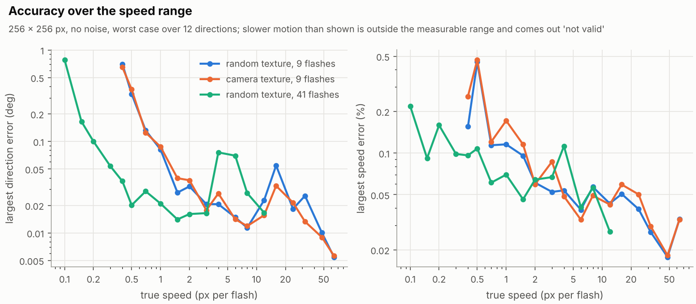
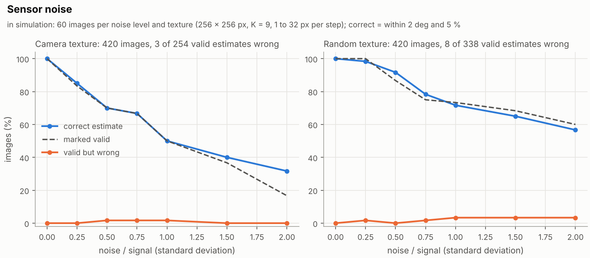
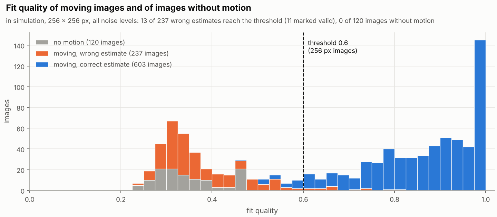
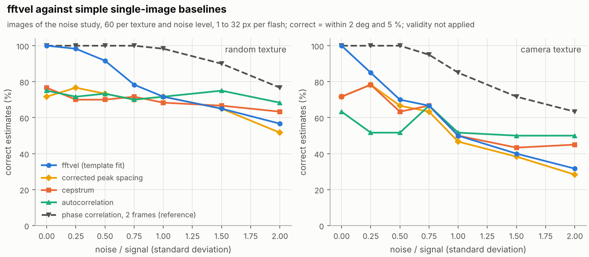
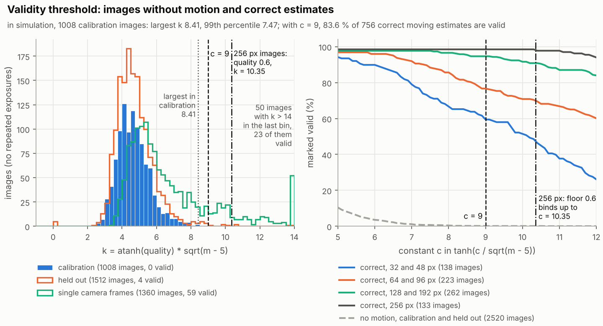

# Results

This page collects all studies, ordered by how independent they are of the
estimator's own model. The first ones use data that `fftvel` did not generate;
the later ones use images from models, and the closer such a model is to the
one the estimator fits, the less a good result proves. The real recordings
are a phone video at 120 frames per second, which the estimator measures in
agreement with phase correlation, and the 2025 Basler frame sequences, whose
uneven steps it rejects. No recording with a physical reference speed and no
real multi-flash image exist yet;
[`data/measurements/README.md`](../data/measurements/README.md) describes the
format they will be evaluated in.

The simulated images hold $K$ instantaneous exposures at equal steps, which is
the mean of $K$ frames with short exposures and equally one exposure with $K$
short flashes. Speeds are given in px per step: per frame for averaged frames,
per flash for a multi-flash image.

Every number comes from the CSV files in
[`experiments/results/`](../experiments/results), written by a full run of
`experiments/run.py --all` on 12 October 2026 (4 CPUs, Python 3.13.16, NumPy
2.5.3, GNU Octave 8.4.0, see `environment.json`). "Correct" always means a
direction within 2 deg and a speed within 5 % of the true values. How the
estimator works is in [method.md](method.md), what an acquisition needs in
[acquisition.md](acquisition.md).

## Phone video at 120 frames per second

A phone moved by hand over the speckled top of a desk, recorded in slow
motion at 120 frames per second with the phone's lamp on: 447 frames,
3.9 s, 5.3 to 13.7 px per frame, close to horizontal. Windows of 5
consecutive frames of a 512 x 512 px square below the lamp's bright spot were
averaged and estimated; the reference is the mean step between the same
frames by phase correlation, which is independent of the estimator but not of
the recording. The video, the script that cuts the frames and all outputs are
in [`data/measurements/2026-10-16_phone_120fps`](../data/measurements/2026-10-16_phone_120fps/README.md).

| | Windows | Valid | Speed against the step: median, 95th percentile, max | Direction: median, max |
|---|---:|---:|---|---|
| Even steps | 68 | 68 | 0.21 %, 0.61 %, 0.81 % | 0.13 deg, 0.52 deg |
| Uneven steps | 21 | 20 | (left out; see below) | |

None of the 68 windows with even steps is off by more than 5 % or 2 deg
(one-sided 95 % upper bound 4.3 %; the windows come from one recording and
are not independent). The phone dropped two frames at four places; the four
valid windows that hold such a gap are 32 to 34 % below the mean step, which
the three times longer step inflates, and within 0.5 % of the median step.
The step check flags all of them, and by the exclusion rule they are left out.
There is no physical reference speed (the ground sample distance was not
measured), no recording of the phone lying still, and the estimator and the
reference share any scale error of the image, such as lens distortion or
rolling shutter.

Three earlier videos of the same desk at 30 frames per second (not in the
repository) moved by 76 to 93 px per frame (median), with steps that varied
by 24 to 36 % within 9 frames and strong motion blur. Of their windows of 5
frames, 51 of 268 were valid, and the share fell with speed: 14 of 21 of the
windows with fairly even steps were valid at 30 to 60 px per frame, 5 of 78
above 90 px. At 120 frames per second the steps are four times smaller and the
exposure shorter.

## Synthetic test sequences

Four sequences of 256 x 256 px from the 2025 student project
(`data/testsequences.mat`). They were made outside `fftvel`: each frame is the
previous one shifted down and to the right, with zero fill at the border, so
they share no code with the estimator's simulator. Every window of 9
consecutive frames was averaged into one pulsed image, cropped to the area
without zero fill and estimated with K = 9 (L = 4). The reference is the phase
correlation of consecutive frames (the shift between two images from the
phase of their cross-power spectrum), averaged over the window. This is the
averaged-frame mode on frames made outside `fftvel`.

| Sequence | Motion per frame | Windows valid | Direction of the valid ones | Largest speed error of the valid ones |
|---|---|---:|---|---|
| model | (5, 5) px, constant | 12 of 12 | 135.01 to 135.03 deg | 0.0035 px (0.05 %) |
| tyre | (4, 4) px, constant | 12 of 12 | 134.93 to 135.02 deg | 0.0044 px (0.08 %) |
| accelerating | vy = 3 px, vx rises from 5.8 to 8 px, falls to 2 px and rises again to 5 px | 17 of 22 | 128.57 to 158.83 deg | 0.65 px (11.1 %) |
| vehicle | irregular steps of 3.50 to 9.93 px | 4 of 22 | 134.34 to 134.92 deg | 1.00 px (14.4 %) |



For constant motion the estimate agrees with an independent generator to
better than 0.005 px. The two irregular sequences break the model on purpose:
the validity check rejects 18 of the 22 vehicle windows, among them 6 that
came out at 1.81 to 2.10 times the reference speed, but 17 of 22 windows of
the accelerating sequence pass with errors up to 11.1 %. The frames are
synthetic, the shifts of the two constant sequences are whole pixels, and no
camera or flash is involved.

```bash
python experiments/testsequences.py
```

## The 2025 recordings

Three recordings of the 2025 project (`data/recordings/vid2.mat` to `vid4.mat`)
show a moving textured surface: 10 frames each from a Basler camera, Mono8,
1936 x 1216 px. They are frame sequences, so they are used as averaged
frames, which needs equal steps between the frames.
The study measured the steps by phase correlation of consecutive frames
(central 1024 x 1024 px) and estimated two 9-frame averages per recording.

| Recording | Step length | Longest / shortest step | Step directions | Fit quality of the two windows | Valid |
|---|---|---:|---|---|---:|
| vid2 | 2.94 to 8.19 px | 2.78 | 135.9 to 165.0 deg | 0.227, 0.264 | 0 of 2 |
| vid3 | 4.53 to 17.99 px | 3.97 | 78.9 to 116.0 deg | 0.234 (isotropic), 0.400 | 0 of 2 |
| vid4 | 1.60 to 6.01 px | 3.76 | 88.8 to 129.3 deg | 0.364, 0.374 | 0 of 2 |



The steps vary by a factor of 2.8 to 4.0 within each recording and their
directions spread over 29 to 41 deg, so the averages do not follow the model.
All six windows are rejected; for the 1024 px square the threshold is 0.6.
This shows that the validity check refuses data that break the model. It says
nothing about the accuracy on real frames with equal steps, which the
[phone video](#phone-video-at-120-frames-per-second) shows, or on multi-flash
images.

```bash
python experiments/recordings_2025.py
```

## Single camera frames: a real null test

A single frame of the recordings holds one exposure, so nothing in it repeats,
and every valid estimate on it is a false alarm. Part 3 of the threshold
calibration estimated a grid of non-overlapping crops of every frame of `vid1`
(a room scene filmed with a moving camera) and of `vid2` to `vid4` (the moving
surface), 256 and 512 px, with K = 3, 5, 9 and 21 (L = 1, 2, 4 and 10) in turn:
1360 crops. The
crops lie at the same 34 positions (28 of 256 px, 6 of 512 px) in each of the
10 frames of a recording, so they are not independent trials. The bound in
the table is the one-sided 95 % Clopper-Pearson upper bound, which assumes
independent trials and is therefore too narrow here: a bootstrap over the 40
frames puts the 95th percentile of the rate over all crops at 6.0 % instead of
5.36 %. Four recordings do not give a general false-alarm rate for real
images. The left panel of the
[threshold figure](figures/threshold.png) shows their values of k (the
size-scaled fit quality of [method.md](method.md#quality-threshold)) next to
those of the simulated images without motion.

| Recording | Square | Valid | 95 % upper bound |
|---|---:|---:|---:|
| vid1 (room scene) | 256 px | 10 of 280 | 5.98 % |
| vid1 (room scene) | 512 px | 2 of 60 | 10.12 % |
| vid2 | 256 px | 0 of 280 | 1.06 % |
| vid2 | 512 px | 0 of 60 | 4.87 % |
| vid3 | 256 px | 15 of 280 | 8.13 % |
| vid3 | 512 px | 4 of 60 | 14.61 % |
| vid4 | 256 px | 17 of 280 | 8.97 % |
| vid4 | 512 px | 11 of 60 | 28.52 % |
| all | | 59 of 1360 | 5.36 % |

The 59 valid crops lie at 40 of the 136 positions; the 11 of `vid4` at 512 px
come from 6 positions, one of them valid in 4 of the 10 frames.

The false alarms on the moving surface look like motion blur. The valid crops
of `vid4` point at about 90 deg (median 90.02 deg, quartiles 89.95 to 90.10
deg), with a median speed of 0.52 px per assumed step and K times the
speed at a median of 4.67 px (quartiles 4.56 to 4.76 px): one exposure blurred
over about 4.7 px looks like K exposures 4.7/K px apart. All 28 valid crops of
`vid4` and 13 of the 19 of `vid3` are blur-like in the sense of the blur check
of [method.md](method.md#blur-check-optional), so `reject_blur` would have
rejected them. The recordings carry no exposure time, so the blur length cannot
be checked against the frame-to-frame motion. On `vid1`, 7 of the 12 valid
crops lie in the 68 crops with at least 10 % saturated pixels.

A simulated control (part 6) reproduces the mechanism: single exposures of the
camera texture moving by d px during one exposure, instead of K exposures.

| Blur d | 1 px | 2 px | 3 px | 4 px | 6 px | 8 px | 12 px |
|---|---:|---:|---:|---:|---:|---:|---:|
| valid (of 24) | 0 | 0 | 2 | 9 | 15 | 15 | 16 |
| blur-like among the valid | 0 | 0 | 1 | 9 | 15 | 14 | 11 |

From 4 px on, the valid ones give K times the speed at a median of 1.01 to
1.08 times d. For a multi-flash image, a blur of a few pixels from continuous
light or vibration during the exposure is the main risk found so far on real
images; [acquisition.md](acquisition.md#ambient-light) says how to avoid it.
With averaged frames each frame is blurred only over its own exposure, which
the duty describes. This test measures false alarms on real camera data; it
does not measure accuracy.

```bash
python experiments/calibrate_threshold.py      # parts 1 to 7, including these two
```

## Model violations in an independent forward model

The estimator fits the ideal model of `fftvel.simulate_pulsed_image`. Good
results on that simulator verify the implementation, nothing more.
[`experiments/model_violations.py`](../experiments/model_violations.py)
renders images with its own forward model, which does not call the simulator:
Fourier shifts of a crop of the camera texture or of a random texture,
sub-steps of at most 0.25 px for the flash duration, and a sensor with
Poisson shot noise, 7 e- read noise, clipping at full scale and quantisation.
In the ideal case it agrees with the simulator to $7.8\cdot10^{-14}$ % in
speed and $2.8\cdot10^{-14}$ deg in direction; a cubic spline shift instead of
the Fourier shift moved the estimate by up to 1.36 % and 0.56 deg. Each factor
breaks one assumption at a time, with 32 images per level (16 per texture),
speeds from 0.5 to 30 px per step, 9 flashes and 256 px. All numbers in this
section come from simulated images. The model renders flashes. For averaged
frames the duty rows stand for the exposure time over the frame interval, the
energy jitter for frames of unequal brightness, for example from flicker, and
the timing jitter for uneven frame times; the rows on continuous light apply
to multi-flash images only.

| Factor | Levels | Correct and valid, first to last level | Wrong but valid |
|---|---|---|---|
| Flash duration / period (duty), default options | 0, 0.1, 0.25, 0.5, 0.75, 0.9 | 100, 100, 87.5, 68.8, 100, 100 % | 12.5 % at 0.25 and 18.8 % at 0.5, speed about duty x speed / K |
| the same with `duty` set | | 100 % at every level | none |
| Flash timing jitter (% of the period) | 0, 1, 2, 5, 10, 20 | 100, 100, 100, 87.5, 56.2, 15.6 % | 9.4 % at 10 and at 20 |
| Flash energy jitter (%) | 0, 2, 5, 10, 20, 40 | 100, 100, 100, 100, 93.8, 84.4 % | none |
| Shot and read noise (full well, mean at 40 %) | none, 100k, 32k, 10k, 3.2k, 1k e- | 100, 96.9, 81.2, 68.8, 56.2, 21.9 % | 3.1 to 6.2 % from 100k to 10k e- (4 images), direction errors of 2.9 to 7.6 deg with the speed within 5 % |
| Quantisation (bits) | none, 12, 10, 8, 6, 4 | 100, 100, 100, 100, 75.0, 9.4 % | 6.2 % at 6 bits, 25.0 % at 4 bits |
| Constant offset (share of the signal, 32k e- sensor) | 0, 0.25, 0.5, 0.75, 0.9 | 78.1, 75.0, 65.6, 43.8, 0 % | 15.6 % at 0 (sensor noise alone), 3.1 % at 0.5 and 0.75 |
| Continuous light, exposure of 10 flash steps (share) | 0, 0.1, 0.25, 0.5, 0.75, 0.9 | 100, 100, 100, 96.9, 65.6, 50.0 % | 3.1 % at 0.5, 34.4 % at 0.75 and 0.9, speed 1.05 to 1.10 times too high |
| Continuous light, exposure of exactly 9 steps | 0, 0.25, 0.5, 0.75, 0.9 | 100 % at every level | none |
| Defocus, disc radius, no noise | 0, 1, 2, 3, 5, 8 px | 100, 100, 100, 96.9, 100, 100 % | none |
| Defocus with the 32k e- sensor | 0, 1, 2, 3, 5 px | 84.4, 62.5, 40.6, 9.4, 0 % | 12.5 % at 0, 3.1 % at 1 px |
| Static sharp edge (step / mean signal) | 0, 0.25, 0.5, 1, 1.5, 2 | 100, 100, 93.8, 87.5, 40.6, 25.0 % | 12.5 % at 1.5, 28.1 % at 2 |
| Periodic texture (tile width, height 3/4 of it) | none, 256, 192, 160, 128, 64 px | 100, 100, 81.2, 43.8, 0, 0 % | 50.0 % at 160 px, 100 % at 128 and 64 px |
| Two static glints (peak / mean signal), default options | 0, 0.3, 1, 3, 10, 100 | 100, 100, 71.9, 3.1, 0, 0 % | 28.1 % at 1, 96.9 % from 3 on |
| the same with `clip_outliers` | | 100 % at every level | none |
| Wrong K given to the estimator (true 9) | 7, 8, 10, 11 | 53.1, 56.2, 56.2, 56.2 % | 34.4 % at each, speed scaled by 9/K |
| Wrong flash count in the image (9 assumed) | 7, 8, 10, 11 | 53.1, 56.2, 59.4, 56.2 % | 34.4 to 37.5 %; with `exposures` set, none |

With 32 images per level one image is 3.1 percentage points, and a share of
12.5 % (4 of 32) has a 95 % confidence interval of 5.0 to 28.1 % (Wilson).
Level 0 of the constant offset and of the defocus with the 32k e- sensor
repeats the 32k e- level of the shot noise, with the same scenes and
velocities and other noise seeds. The three give 2, 5 and 4 of 32 wrong but
valid and 81.2, 78.1 and 84.4 % correct and valid, so differences of a few
images between levels are within the scatter of the noise seeds.



Uneven intervals come from part 5 of the threshold calibration, which
renders the flashes at chosen times with the same kind of Fourier shift. The
same images stand for an averaged window of frames taken at uneven times, and
one flash missing for a dropped frame.

| Flash intervals | Images | Correct | Valid | Valid but wrong | At twice the speed |
|---|---:|---:|---:|---:|---:|
| alternating 0.8 and 1.2 periods | 240 | 36 | 130 | 95 | 87 |
| one flash missing | 240 | 128 | 129 | 22 | 0 (median speed 1.09 times too high) |

The study shows which violations give wrong results that are still marked
valid: an unknown flash or exposure duration, flash jitter from 10 % of the period, half
or more of the light from a continuous source over a longer exposure, strong
static edges, periodic textures, glints, a wrong flash count and uneven
intervals. The score at half the estimated speed did not separate the
twice-speed results from correct ones for alternating intervals (area under
the ROC curve 0.695), and the estimator has no such check. The forward model
is still a model: lens distortion, rolling shutter, vignetting and real flash
pulse shapes are not in it.

```bash
python experiments/model_violations.py
```

## Accuracy and noise in simulation

These images come from `fftvel.simulate_pulsed_image`, which moves a fixed
window over a larger texture with exact Fourier shifts and instantaneous,
equally spaced exposures (frames with short exposures, or flashes): the same
model the estimator fits. They verify the
implementation and its behaviour under noise, in simulation.

Accuracy: 256 x 256 px, no noise, 12 directions from 0 to 165 deg, a random
texture and the camera texture of `data/surface_texture.png`.

| Texture, flashes | Valid at every direction | Largest direction error | Largest speed error | The same from 1 px on |
|---|---|---:|---:|---|
| random, K = 9 | 0.4 to 64 px per step | 0.70 deg | 0.45 % | 0.081 deg, 0.12 % |
| camera, K = 9 | 0.4 to 64 px per step | 0.65 deg | 0.47 % | 0.087 deg, 0.17 % |
| random, K = 41 | 0.1 to 12 px per step | 0.78 deg | 0.22 % | 0.076 deg, 0.11 % |

The median errors are below 0.012 deg and 0.03 % in all three series. At
0.3 px per step with K = 9, below the lower end of 0.37 px, all 24 images came
out not valid.



Noise: 60 images per texture and noise level, with random velocities (speed
log-uniform from 1 to 32 px per step, any direction), K = 9, 256 px and white
noise whose standard deviation is the given multiple of the image's.

| Noise / signal | Random texture: correct, valid | Camera texture: correct, valid | Valid but wrong (both) |
|---:|---|---|---:|
| 0 | 100 %, 100 % | 100 %, 100 % | 0 of 120 |
| 0.25 | 98.3 %, 100 % | 85.0 %, 83.3 % | 1 of 110 |
| 0.5 | 91.7 %, 86.7 % | 70.0 %, 70.0 % | 1 of 94 |
| 0.75 | 78.3 %, 75.0 % | 66.7 %, 66.7 % | 2 of 85 |
| 1 | 71.7 %, 73.3 % | 50.0 %, 50.0 % | 3 of 74 |
| 1.5 | 65.0 %, 68.3 % | 40.0 %, 36.7 % | 2 of 63 |
| 2 | 56.7 %, 60.0 % | 31.7 %, 16.7 % | 2 of 46 |

Of the 592 valid estimates, 11 were wrong: 6 by a direction error of 2.02 to
3.72 deg with the speed still within 5 %, and 5, all at noise of half the
signal or more, at 1.97 to 2.05 times the true speed. None of 120 images
without motion (random and camera texture, noise 0, 0.5 and 1) was valid;
their highest fit quality was 0.468. The camera texture loses more estimates to
noise than the random one.




```bash
python experiments/accuracy.py
python experiments/noise.py
```

## Baselines

[`experiments/baselines.py`](../experiments/baselines.py) runs simple
single-image methods on the 840 images of the noise study, in simulation:
the strongest peak of the power cepstrum (the inverse FFT of the log power
spectrum, which turns repeated copies into peaks at their offset), the
strongest side peak of the autocorrelation, and the speed from the spacing of
the main lines in the `fftvel` profile, the 2025 approach with its faults
removed. Phase correlation between two consecutive single exposures needs two
frames and serves as an upper reference. With averaged frames the separate
frames exist, so it is available; for a multi-flash image it needs two extra
single-flash frames. The parameters of the baselines were
chosen on separate images with other seeds.

| Method | Input | Correct, random texture | Correct, camera texture |
|---|---|---:|---:|
| `fftvel` | one image of 9 exposures | 80.2 % | 63.3 % |
| corrected peak spacing | one image of 9 exposures | 68.6 % | 56.2 % |
| cepstrum | one image of 9 exposures | 69.5 % | 59.8 % |
| autocorrelation | one image of 9 exposures | 72.1 % | 55.0 % |
| phase correlation | two overlapping single exposures | 95.0 % | 87.9 % |

| True speed (px per step) | 1 to 2 | 2 to 4 | 4 to 8 | 8 to 16 | 16 to 32 |
|---|---:|---:|---:|---:|---:|
| `fftvel` | 28.0 % | 56.1 % | 82.0 % | 94.2 % | 98.1 % |
| corrected peak spacing | 0.0 % | 43.9 % | 76.2 % | 93.6 % | 97.5 % |
| cepstrum | 1.8 % | 48.5 % | 79.1 % | 93.6 % | 99.4 % |
| autocorrelation | 0.0 % | 33.9 % | 85.5 % | 97.7 % | 100 % |
| phase correlation (two frames) | 70.1 % | 90.6 % | 97.7 % | 98.2 % | 100 % |



The methods run on the same images, so the exact McNemar test on the images
where two methods disagree compares them. On the random texture `fftvel` is
correct more often than each single-image baseline over all 420 images
(p < 0.001), and at each noise level up to half the signal (p < 0.01). On the
camera texture it is correct in 266 of 420 images and the cepstrum in 251, a
difference that is not significant (41 against 26 images where only one of
the two is correct, p = 0.09). The difference comes from the 60 images
without noise, where `fftvel` is correct in 60 and the cepstrum and the
corrected peak spacing in 43 each; on the 360 noisy images the cepstrum is
correct in 208, `fftvel` in 206. At noise of a quarter and half the signal the
lead of `fftvel` over the cepstrum on the camera texture is 4 against 0 and 5
against 1 images (p = 0.13 and 0.22). Below 2 px per step `fftvel` is correct
in 28.0 % of the images, the single-image baselines in at most 1.8 %. With
noise as strong as the signal or stronger,
the autocorrelation matches or beats it on both textures. Only `fftvel` has a
validity flag: it marked 80.5 % (random) and 60.5 % (camera texture) of the
images valid, and 1.9 % and 0.7 % were valid but wrong. If two overlapping
single frames are available, as they are with averaged frames, phase
correlation is more accurate and also gives the sign of the motion.

```bash
python experiments/baselines.py
```

## Threshold calibration

[`experiments/calibrate_threshold.py`](../experiments/calibrate_threshold.py)
checks the constant 9 of the quality threshold
$\tanh(9/\sqrt{m-5})$ ([method.md](method.md#quality-threshold)). Each image
gives $k = \operatorname{atanh}(q)\,\sqrt{m-5}$; the quality alone passes
exactly when $k \ge 9$.

| Set | Images | Valid | 95 % upper bound | Largest k |
|---|---:|---:|---:|---:|
| 1. calibration: white noise, static random and camera texture, 32 to 256 px, simulated | 1008 | 0 | 0.30 % | 8.41 |
| 2. held out, simulated: new seeds, other correlation lengths, power-law spectra | 1260 | 0 | 0.24 % | 8.64 |
| 2. held out, real: single-frame crops of the room scene `vid1` | 252 | 4 | 3.60 % | 22.15 |
| 3. single camera frames (see above) | 1360 | 59 | 5.36 % | 25.25 |
| 7. crops of the camera texture without added noise | 588 | 1 | 0.80 % | 10.19 |

All 2268 simulated images without motion together gave 0 valid (upper bound
0.13 %), with a largest k of 8.64. Three of the four valid `vid1` crops have
35 % or more saturated pixels. The bounds of the two real sets assume
independent crops, but the crops come from only 10 frames per recording, so
these bounds are too narrow
(see [single camera frames](#single-camera-frames-a-real-null-test)). The one
valid crop of part 7 is a 128 px crop with K = 3 (L = 1); with the small
amount of noise of part 1 added, the same crop gives k = 6.22.

Part 4 measures the cost in simulation, on 1344 moving images of the camera
texture (random velocity, K from 3 to 21, noise 0 to 1, 32 to 256 px), of which 756 were
correct. With the constant 9, 83.6 % of the correct estimates are valid: 52.7 %
at 32 px, 79.5 % at 96 px, 89.3 % at 128 px and 98.5 % at 256 px. At 256 px the
floor of 0.6 corresponds to k = 10.35, so any constant up to that value gives
the same threshold there.
Of the 588 wrong estimates, 16 are valid.

| Rule (all with range and isotropy check) | Correct estimates kept | Wrong valid | Null images valid | Camera frames valid |
|---|---:|---:|---:|---:|
| quality threshold with 9 (current) | 83.6 % | 16 | 4 | 59 |
| GEBA of at least 1.55 alone | 85.4 % | 74 | 103 | 24 |
| current rule and GEBA of at least 1.5 | 77.0 % | 4 | 3 | 6 |



The size-scaled quality separates correct moving estimates from images
without motion better than GEBA (area under the ROC curve 0.988 against
0.947). GEBA rejects more of the blurred single camera frames, and combining
the two would cut those false alarms from 59 to 6 at the cost of 6.6
percentage points of correct estimates; the estimator does not do this. The
constant was checked on the same simulated sets that give 0 false alarms, so
the rate on real frames averaged at equal steps and on real multi-flash images
is unknown until such recordings exist.

```bash
python experiments/calibrate_threshold.py
```

## Run time

[`experiments/timing.py`](../experiments/timing.py) times
`estimate_velocity` with the defaults (K = 9, padding 2) on simulated square
images. The first call runs in a fresh process and includes the set-up of the
projection weights; the repeated call is what a loop over camera frames costs.
Medians in seconds, on 4 CPUs; the import of `fftvel` with NumPy adds 0.08 to
0.09 s in Python.

| Square | FFT length | Python, first call | Python, repeated | Octave, first call | Octave, repeated |
|---:|---:|---:|---:|---:|---:|
| 128 px | 256 | 0.207 | 0.152 | 0.340 | 0.276 |
| 256 px | 512 | 0.864 | 0.611 | 1.205 | 0.936 |
| 512 px | 1024 | 4.894 | 3.958 | 6.423 | 5.002 |
| 1024 px | 2048 | 23.0 | 18.1 | 30.5 | 24.2 |

Each doubling of the side multiplies the repeated run time by 4.0 to 6.5 in
Python. At 512 px one estimate takes about 4 s, far from video rate.

```bash
python experiments/timing.py
```

## Reproducing the results

```bash
python -m pip install -e "./python[plot,data]"
python experiments/run.py                 # accuracy, noise, before_after, pipeline, testsequences, recordings
python experiments/run.py --all           # also calibration, baselines, violations, timing
python experiments/run.py --quick --all   # smaller grids, written to experiments/results_quick/
python experiments/run.py --replot --all  # redraw the figures and print the numbers from the CSV files
```

A full run writes the CSV files to `experiments/results/` and the figures to
`docs/figures/`; `--quick` never overwrites them. Each study also runs alone,
as in the commands above. The before and after comparison of the 2025 code
with the rework is in [history.md](history.md#before-and-after).
